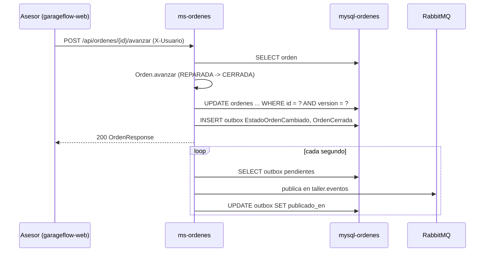

# Diseño: 01-ordenes

Estado: APROBADO (2026-11-12, Developer)

## Resumen

`ms-ordenes` guarda la orden y aplica sus transiciones en el dominio (`Orden`). Cada cambio genera
eventos de dominio. El caso de uso guarda la orden y escribe sus eventos en la tabla `outbox` en
la misma transacción; `OutboxRelay` los publica en RabbitMQ cada segundo (D-07).

Cubre: REQ-1, REQ-2, REQ-3, REQ-4, REQ-5, REQ-6, REQ-7.

## Decisiones aplicadas

- D-02: estados y regla de reapertura.
- D-07: outbox en la misma transacción.
- D-08: el evento `OrdenCerrada` dispara la cancelación de citas en `ms-agenda`.
- D-11: el caso de uso recibe el `origen`; el controlador del asesor usa `ASESOR`.
- D-14: el usuario llega en `X-Usuario`.
- D-21: Spring Data JPA con Hibernate; `@Version` detecta los cambios simultáneos.
- Convenciones de `00-base`: paquetes, `ErrorDeNegocio`, problem details, exchange y outbox.
- Decisiones nuevas: ninguna.

## Proyectos afectados

| Proyecto | Qué cambia | Datos propios que toca |
|---|---|---|
| `services/ms-ordenes` | Dominio, caso de uso, API REST, persistencia y outbox | `ordenes`, `outbox` |

## Ubicación hexagonal

Paquete base `com.subacol.msordenes`.

| Clase | Capa | Responsabilidad |
|---|---|---|
| `Orden` | `domain` | Agregado. `registrar`, `avanzar`, `reabrir`, `accionesPermitidas`, `siguienteEstado`, `extraerEventos`; `reconstituir` para leerla de la base. Lleva `version` (`Long`, `null` si es nueva) para detectar cambios simultáneos |
| `DatosOrden` | `domain` | Record con cliente, vehículo, aseguradora y trabajo; valida los obligatorios y convierte vacíos en `null` |
| `EstadoOrden` | `domain` | Enum con `siguiente()` |
| `Origen` | `domain` | Enum `ASESOR`, `ASEGURADORA` |
| `AccionOrden` | `domain` | Enum `AVANZAR`, `REABRIR` |
| `EstadoOrdenCambiado` | `domain` | Evento de dominio (record) |
| `OrdenCerrada` | `domain` | Evento de dominio (record) |
| `OrdenesUseCase` | `application.port.in` | `registrar`, `avanzar`, `reabrir`, `obtener`, `listar` |
| `RegistrarOrdenComando` | `application.port.in` | Record: `datos`, `origen`, `usuario` |
| `OrdenRepository` | `application.port.out` | `guardarNueva(orden)`, `Optional<Orden> buscar(id)`, `List<Orden> listar()`, `boolean actualizar(orden)` (`false` si otro usuario cambió la orden después de leerla) |
| `PublicadorEventos` | `application.port.out` | `publicar(List<Object> eventos)` |
| `OrdenesService` | `application.service` | Implementa el caso de uso; `@Transactional` en `registrar`, `avanzar` y `reabrir` |
| `OrdenesController` | `adapter.in.web` | `/api/ordenes` |
| `RegistrarOrdenRequest`, `ReabrirOrdenRequest`, `OrdenResponse` | `adapter.in.web` | DTO |
| `OrdenEntity` | `adapter.out.persistence` | `@Entity` de `ordenes`, con `@Version Long version` |
| `OrdenJpaRepository` | `adapter.out.persistence` | `JpaRepository<OrdenEntity, String>` con `findAllByOrderByCreadaEnDesc()` |
| `OrdenPersistenceAdapter` | `adapter.out.persistence` | Implementa `OrdenRepository`. `actualizar` arma la entidad con la versión que trae la orden y llama a `saveAndFlush`; si Hibernate encuentra otra versión (`OptimisticLockingFailureException`), devuelve `false` |
| `OutboxEntity`, `OutboxJpaRepository` | `adapter.out.messaging` | Tabla `outbox` (convención de `00-base`) |
| `OutboxPublicador` | `adapter.out.messaging` | Pasa cada evento de dominio a su JSON versión 1 y lo guarda como `OutboxEntity` |
| `OutboxRelay` | `adapter.out.messaging` | Publica las filas pendientes (convención de `00-base`) |
| `EstadoOrdenCambiadoV1`, `OrdenCerradaV1` | `adapter.out.messaging` | DTO JSON de los eventos |

## Reglas del dominio

- `Orden.registrar(id, datos, origen, usuario, ahora)`: exige `usuario` no vacío
  (`USUARIO_REQUERIDO`); deja la orden en `REGISTRADA`; agrega `EstadoOrdenCambiado` con
  `estadoAnterior` vacío.
- `DatosOrden`: `clienteNombre`, `clienteTelefono`, `vehiculoPlaca` y `trabajo` son obligatorios
  (`DATOS_INVALIDOS`, tipo `INVALIDO`). Recorta espacios. `vehiculoDescripcion` y `aseguradora`
  vacías quedan en `null`.
- `avanzar(usuario, ahora)`: exige usuario; si el estado es `CERRADA`, `TRANSICION_INVALIDA`
  (tipo `CONFLICTO`); si no, pasa a `siguiente()`, actualiza `actualizadaEn` y agrega
  `EstadoOrdenCambiado`. Si el nuevo estado es `CERRADA`, agrega también `OrdenCerrada`.
- `reabrir(motivo, usuario, ahora)`: exige usuario; si el motivo falta o está vacío,
  `MOTIVO_REQUERIDO` (tipo `INVALIDO`); si el estado no es `REPARADA` ni `CERRADA`,
  `TRANSICION_INVALIDA`. Si pasa las dos, queda en `EN_REPARACION` y agrega `EstadoOrdenCambiado`
  con el motivo.
- `accionesPermitidas()`: `AVANZAR` si no está `CERRADA`; `REABRIR` si está `REPARADA` o `CERRADA`.
- `siguienteEstado()`: devuelve `estado.siguiente()`. `EstadoOrden.siguiente()` devuelve el estado
  que sigue, o `null` para `CERRADA`. `OrdenResponse` copia el valor tal cual.
- `extraerEventos()`: devuelve los eventos pendientes y vacía la lista.
- `version`: la orden nueva no tiene (`null`); la que se lee de la base trae la suya. El dominio
  no la cambia; la usa el adaptador para detectar cambios simultáneos.
- Las horas salen del `Clock` y se truncan a milisegundos.

## Caso de uso

- `registrar(comando)`: crea la orden con un UUID nuevo, `guardarNueva`, `publicar(extraerEventos())`.
- `avanzar(id, usuario)` y `reabrir(id, motivo, usuario)`: `buscar` (si no existe,
  `ORDEN_NO_ENCONTRADA`, tipo `NO_ENCONTRADO`); aplica el cambio en el dominio;
  `actualizar(orden)`; publica los eventos. Si `actualizar` devuelve `false`, lanza
  `ORDEN_MODIFICADA` (tipo `CONFLICTO`) y no se publica nada.
- `obtener(id)` y `listar()`: lectura.

## Contratos

### REST

| Método y ruta | Entrada | Respuestas | Criterios |
|---|---|---|---|
| `POST /api/ordenes` | cabecera `X-Usuario`; cuerpo `RegistrarOrdenRequest` | 201 `OrdenResponse`; 400 `DATOS_INVALIDOS`; 400 `USUARIO_REQUERIDO` | REQ-1, REQ-4.1, REQ-7.1 |
| `GET /api/ordenes` | — | 200 lista de `OrdenResponse` | REQ-5.1 |
| `GET /api/ordenes/{id}` | — | 200 `OrdenResponse`; 404 `ORDEN_NO_ENCONTRADA` | REQ-5.2 |
| `POST /api/ordenes/{id}/avanzar` | cabecera `X-Usuario` | 200 `OrdenResponse`; 400 `USUARIO_REQUERIDO`; 404 `ORDEN_NO_ENCONTRADA`; 409 `TRANSICION_INVALIDA`; 409 `ORDEN_MODIFICADA` | REQ-2, REQ-4.1 |
| `POST /api/ordenes/{id}/reabrir` | cabecera `X-Usuario`; cuerpo `{ "motivo": "..." }` (opcional) | 200 `OrdenResponse`; 400 `MOTIVO_REQUERIDO`; 400 `USUARIO_REQUERIDO`; 404 `ORDEN_NO_ENCONTRADA`; 409 `TRANSICION_INVALIDA`; 409 `ORDEN_MODIFICADA` | REQ-3, REQ-4.1 |

- `RegistrarOrdenRequest`: `clienteNombre` (obligatorio, hasta 120), `clienteTelefono`
  (obligatorio, hasta 30), `vehiculoPlaca` (obligatoria, hasta 15), `vehiculoDescripcion` (hasta
  120), `aseguradora` (hasta 120), `trabajo` (obligatorio, hasta 1000). Validado con
  `jakarta.validation`.
- `ReabrirOrdenRequest`: `motivo` (hasta 500). El cuerpo es opcional (`@RequestBody(required =
  false)`); si falta, el motivo es `null` y responde el dominio con `MOTIVO_REQUERIDO`.
- `X-Usuario` se lee con `@RequestHeader(value = "X-Usuario", required = false)`; el dominio
  decide `USUARIO_REQUERIDO`, así la regla también vale para la integración futura.
- `OrdenResponse`: `id`, `clienteNombre`, `clienteTelefono`, `vehiculoPlaca`,
  `vehiculoDescripcion`, `aseguradora`, `trabajo`, `origen`, `estado`, `siguienteEstado`,
  `accionesPermitidas`, `creadaEn`, `actualizadaEn`.
- `ms-agenda` usa `GET /api/ordenes/{id}` para leer `estado`, `clienteNombre` y
  `clienteTelefono` (spec `03`).

### Eventos

| Evento y versión | Publica | Consume | Campos |
|---|---|---|---|
| `EstadoOrdenCambiado` v1 | `ms-ordenes` | `ms-auditoria` | `eventoId`, `tipo`, `version`, `ocurridoEn`, `ordenId`, `estadoAnterior`, `estadoNuevo`, `motivo`, `usuario`, `origen` |
| `OrdenCerrada` v1 | `ms-ordenes` | `ms-agenda` | `eventoId`, `tipo`, `version`, `ocurridoEn`, `ordenId`, `usuario` |

Ejemplo:

```json
{ "eventoId": "3f0c…", "tipo": "EstadoOrdenCambiado", "version": 1, "ocurridoEn": "2026-11-12T15:30:00.125",
  "ordenId": "9a1e…", "estadoAnterior": "REPARADA", "estadoNuevo": "CERRADA", "motivo": null,
  "usuario": "asesor.ana", "origen": "ASESOR" }
```

## Modelo de datos

`services/ms-ordenes/db/init.sql`:

```sql
CREATE TABLE ordenes (
  id                   VARCHAR(36)   NOT NULL PRIMARY KEY,
  cliente_nombre       VARCHAR(120)  NOT NULL,
  cliente_telefono     VARCHAR(30)   NOT NULL,
  vehiculo_placa       VARCHAR(15)   NOT NULL,
  vehiculo_descripcion VARCHAR(120)  NULL,
  aseguradora          VARCHAR(120)  NULL,
  trabajo              VARCHAR(1000) NOT NULL,
  origen               VARCHAR(20)   NOT NULL,
  estado               VARCHAR(20)   NOT NULL,
  creada_en            DATETIME(3)   NOT NULL,
  actualizada_en       DATETIME(3)   NOT NULL,
  version              BIGINT        NOT NULL DEFAULT 0,
  CONSTRAINT ck_ordenes_estado CHECK (estado IN ('REGISTRADA','EN_DIAGNOSTICO','EN_REPARACION','REPARADA','CERRADA')),
  CONSTRAINT ck_ordenes_origen CHECK (origen IN ('ASESOR','ASEGURADORA'))
);

CREATE TABLE outbox (
  id           VARCHAR(36)   NOT NULL PRIMARY KEY,
  routing_key  VARCHAR(60)   NOT NULL,
  payload      VARCHAR(4000) NOT NULL,
  creado_en    DATETIME(3) NOT NULL,
  publicado_en DATETIME(3) NULL,
  INDEX ix_outbox_pendientes (publicado_en, creado_en)
);
```

- Cambio de estado: Hibernate genera `UPDATE ordenes SET ..., version = ? WHERE id = ? AND version = ?`.
  Si cambia 0 filas, el adaptador devuelve `false` y el caso de uso responde `ORDEN_MODIFICADA`
  (REQ-2.4).
- Lista: `findAllByOrderByCreadaEnDesc()` (REQ-5.1).

## Flujo



## Errores y casos límite

| Caso | Respuesta | Criterio |
|---|---|---|
| Orden sin `trabajo` | 400 `DATOS_INVALIDOS`, con `errores.trabajo` | REQ-1.2 |
| Sin cabecera `X-Usuario` | 400 `USUARIO_REQUERIDO` | REQ-4.1 |
| Avanzar una orden `CERRADA` | 409 `TRANSICION_INVALIDA` | REQ-2.2 |
| Reabrir sin motivo y desde un estado no permitido | 400 `MOTIVO_REQUERIDO` (el motivo se valida primero) | REQ-3.2 |
| Dos usuarios avanzan la misma orden a la vez | El primero gana; el segundo recibe 409 `ORDEN_MODIFICADA` | REQ-2.4 |
| RabbitMQ caído | El cambio responde 200; las filas quedan en `outbox` hasta que RabbitMQ vuelve | REQ-6.4 |

## Estrategia de pruebas

`OrdenTest` (dominio) y `OrdenesServiceTest` (caso de uso, con repositorio y publicador falsos en
memoria y un `Clock` fijo) corren dentro de la construcción de la imagen.

| Criterio | Prueba | Tipo |
|---|---|---|
| REQ-1.1 | `OrdenTest`: "REQ-1.1 registrar deja la orden REGISTRADA"; `OrdenesServiceTest`: "REQ-1.1 registrar guarda la orden y publica su evento" | dominio, caso de uso |
| REQ-1.2 | `OrdenTest`: "REQ-1.2 registrar sin placa es rechazado con DATOS_INVALIDOS"; `scripts/prueba-ordenes.ps1` (400 con `errores.trabajo`) | dominio, manual |
| REQ-1.3 | `OrdenTest`: "REQ-1.3 sin aseguradora queda como particular" | dominio |
| REQ-2.1 | `OrdenTest`: "REQ-2.1 avanzar recorre los estados en orden" | dominio |
| REQ-2.2 | `OrdenTest`: "REQ-2.2 avanzar una orden CERRADA es rechazado" | dominio |
| REQ-2.3 | `OrdenesServiceTest`: "REQ-2.3 avanzar una orden inexistente responde ORDEN_NO_ENCONTRADA" | caso de uso |
| REQ-2.4 | `OrdenesServiceTest`: "REQ-2.4 si la orden cambió en paralelo no se publican eventos"; `OrdenEntity` tiene `@Version` y el adaptador traduce `OptimisticLockingFailureException` a `false` | caso de uso, revisión estática |
| REQ-3.1 | `OrdenTest`: "REQ-3.1 reabrir una orden REPARADA o CERRADA la deja EN_REPARACION" | dominio |
| REQ-3.2 | `OrdenTest`: "REQ-3.2 reabrir sin motivo es rechazado con MOTIVO_REQUERIDO" | dominio |
| REQ-3.3 | `OrdenTest`: "REQ-3.3 reabrir desde REGISTRADA es rechazado" | dominio |
| REQ-4.1 | `OrdenTest`: "REQ-4.1 cambiar sin usuario es rechazado con USUARIO_REQUERIDO"; `scripts/prueba-ordenes.ps1` (sin cabecera) | dominio, manual |
| REQ-5.1 | `scripts/prueba-ordenes.ps1`: la orden recién creada es la primera de la lista | manual |
| REQ-5.2 | `OrdenTest`: "REQ-5.2 acciones permitidas y siguiente estado según el estado"; `scripts/prueba-ordenes.ps1` revisa `siguienteEstado` y `accionesPermitidas` en cada respuesta | dominio, manual |
| REQ-6.1 | `OrdenTest`: "REQ-6.1 cada cambio genera EstadoOrdenCambiado con sus datos" | dominio |
| REQ-6.2 | `OrdenTest`: "REQ-6.2 pasar a CERRADA genera OrdenCerrada" | dominio |
| REQ-6.3 | `@Transactional` en el caso de uso; `OutboxPublicador` guarda con un repositorio JPA dentro de esa transacción | revisión estática |
| REQ-6.4 | `docker compose stop rabbitmq`; avanzar una orden (200); `docker compose start rabbitmq`; el cambio aparece en el historial de `ms-auditoria` en menos de 1 minuto | manual |
| REQ-7.1 | `OrdenesController` arma el comando con `Origen.ASESOR`; `scripts/prueba-ordenes.ps1` ve `origen = ASESOR` | revisión estática, manual |
| REQ-7.2 | `OrdenesServiceTest`: "REQ-7.2 registrar con origen ASEGURADORA conserva el origen" | caso de uso |

## Riesgos

- Si el relay cae entre el envío y la marca de `publicado_en`, el evento se publica dos veces. Los
  consumidores descartan repetidos por `eventoId` (D-07).

## Cambios

- 2026-11-12: persistencia con Spring Data JPA y Hibernate (D-21), pedida por el Developer al
  aprobar; `@Version` reemplaza al `UPDATE` condicional.
