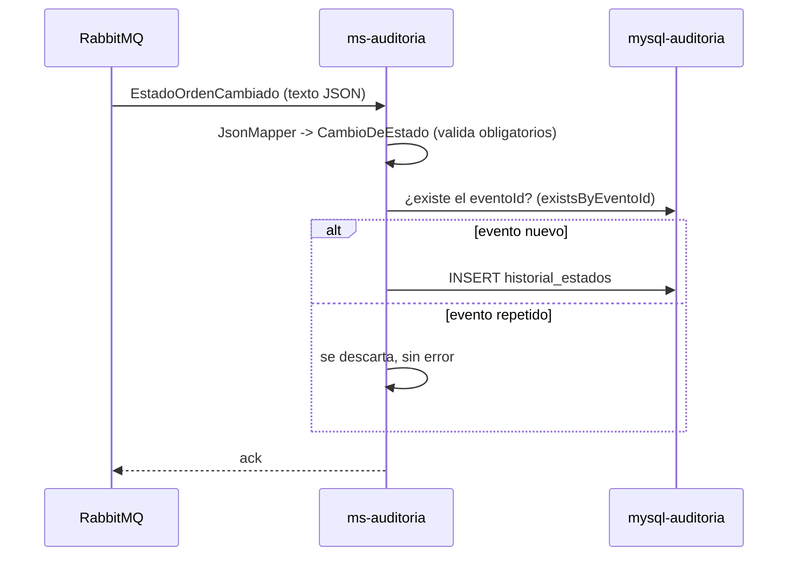

# Diseño: 02-auditoria

Estado: APROBADO (2026-11-12, Developer)

## Resumen

`ms-auditoria` escucha `EstadoOrdenCambiado`, guarda cada cambio en la tabla `historial_estados`
y lo expone para consulta. La base de datos impide alterar el historial: dos triggers rechazan
`UPDATE` y `DELETE` para cualquier usuario, y el usuario de la aplicación solo tiene `SELECT` e
`INSERT` (D-10).

Cubre: REQ-1, REQ-2, REQ-3.

## Decisiones aplicadas

- D-04: `ms-auditoria` es dueño del historial; `ms-ordenes` no tiene acceso a su base.
- D-07: consumidor idempotente por `eventoId`.
- D-10: protección en la base de datos.
- D-12: los scripts de `db/` crean la tabla, los triggers y el usuario.
- D-21: Spring Data JPA; la entidad del historial es `@Immutable`.
- Convenciones de `00-base`: cola con DLQ, reintentos, problem details.
- Decisiones nuevas: ninguna. La nota de D-10 sobre `db/usuario-app.sh` ya está en `DECISIONES.md`.

## Proyectos afectados

| Proyecto | Qué cambia | Datos propios que toca |
|---|---|---|
| `services/ms-auditoria` | Dominio, caso de uso, consumidor, API REST, persistencia, scripts de base | `historial_estados` |

## Ubicación hexagonal

Paquete base `com.subacol.msauditoria`.

| Clase o archivo | Capa | Responsabilidad |
|---|---|---|
| `CambioDeEstado` | `domain` | Record con `eventoId`, `ordenId`, `estadoAnterior`, `estadoNuevo`, `motivo`, `usuario`, `origen`, `ocurridoEn`. Su constructor rechaza los obligatorios vacíos con `EVENTO_INVALIDO` (tipo `INVALIDO`) |
| `HistorialUseCase` | `application.port.in` | `boolean registrar(CambioDeEstado)`, `List<CambioDeEstado> historialDeOrden(String ordenId)`, `List<CambioDeEstado> ultimosCambios()` |
| `HistorialRepository` | `application.port.out` | `boolean agregar(CambioDeEstado)` (falso si el `eventoId` ya existe), `porOrden(String)`, `ultimos(int)` |
| `HistorialService` | `application.service` | Implementa el caso de uso; `ultimosCambios()` consulta `ultimos(200)` |
| `EstadoOrdenCambiadoListener` | `adapter.in.messaging` | `@RabbitListener` de `auditoria.orden-estado-cambiado`; lee el texto con `JsonMapper`, arma `CambioDeEstado` y llama al caso de uso |
| `EstadoOrdenCambiadoV1` | `adapter.in.messaging` | DTO del evento, con `@JsonIgnoreProperties(ignoreUnknown = true)` |
| `HistorialController` | `adapter.in.web` | `GET /api/auditoria/historial`: con `ordenId` llama a `historialDeOrden`; sin él, a `ultimosCambios` |
| `CambioDeEstadoResponse` | `adapter.in.web` | DTO de salida |
| `CambioDeEstadoEntity` | `adapter.out.persistence` | `@Entity` y `@Immutable` (Hibernate) de `historial_estados`; `id` con `@GeneratedValue(strategy = IDENTITY)`; no mapea `registrado_en`, que lo pone la base |
| `HistorialJpaRepository` | `adapter.out.persistence` | `existsByEventoId`, `findByOrdenIdOrderByOcurridoEnAscIdAsc`, `findAllByOrderByOcurridoEnDescIdDesc(Limit)` |
| `HistorialPersistenceAdapter` | `adapter.out.persistence` | Implementa `HistorialRepository`: si `existsByEventoId`, devuelve `false`; si no, guarda y devuelve `true` |
| `RabbitConfig` | `config` | Agrega la cola `auditoria.orden-estado-cambiado` (con DLQ) y su enlace a `orden.estado-cambiado` |
| `db/init.sql` | — | Tabla y triggers |
| `db/usuario-app.sh` | — | Crea `auditoria_app` con la contraseña de `AUDITORIA_APP_PASSWORD` y le da `SELECT` e `INSERT` sobre `historial_estados`. Fin de línea LF |

## Contratos

### REST

| Método y ruta | Entrada | Respuestas | Criterios |
|---|---|---|---|
| `GET /api/auditoria/historial?ordenId={id}` | `ordenId` opcional | 200 lista de `CambioDeEstadoResponse` | REQ-3.1, REQ-3.2 |

`CambioDeEstadoResponse`: `eventoId`, `ordenId`, `estadoAnterior`, `estadoNuevo`, `motivo`,
`usuario`, `origen`, `ocurridoEn`.

### Eventos

| Evento y versión | Publica | Consume | Campos que usa |
|---|---|---|---|
| `EstadoOrdenCambiado` v1 | `ms-ordenes` | `ms-auditoria` | `eventoId`, `ocurridoEn`, `ordenId`, `estadoAnterior`, `estadoNuevo`, `motivo`, `usuario`, `origen` |

Cola `auditoria.orden-estado-cambiado`, enlazada a `taller.eventos` con `orden.estado-cambiado`,
con dead letter a `auditoria.orden-estado-cambiado.dlq`.

## Modelo de datos

`services/ms-auditoria/db/init.sql` (corre como root la primera vez):

```sql
CREATE TABLE historial_estados (
  id              BIGINT       NOT NULL AUTO_INCREMENT PRIMARY KEY,
  evento_id       VARCHAR(36)  NOT NULL,
  orden_id        VARCHAR(36)  NOT NULL,
  estado_anterior VARCHAR(20)  NULL,
  estado_nuevo    VARCHAR(20)  NOT NULL,
  motivo          VARCHAR(500) NULL,
  usuario         VARCHAR(100) NOT NULL,
  origen          VARCHAR(20)  NOT NULL,
  ocurrido_en     DATETIME(3)  NOT NULL,
  registrado_en   DATETIME(3)  NOT NULL DEFAULT CURRENT_TIMESTAMP(3),
  CONSTRAINT uk_historial_evento UNIQUE (evento_id),
  INDEX ix_historial_orden (orden_id, ocurrido_en)
);

CREATE TRIGGER historial_sin_update BEFORE UPDATE ON historial_estados FOR EACH ROW
  SIGNAL SQLSTATE '45000' SET MESSAGE_TEXT = 'historial_estados es de solo insercion';

CREATE TRIGGER historial_sin_delete BEFORE DELETE ON historial_estados FOR EACH ROW
  SIGNAL SQLSTATE '45000' SET MESSAGE_TEXT = 'historial_estados es de solo insercion';
```

`services/ms-auditoria/db/usuario-app.sh` (corre después de `init.sql`, por orden alfabético):

```sh
#!/bin/sh
set -e
mysql --protocol=socket -uroot -p"$MYSQL_ROOT_PASSWORD" <<SQL
CREATE USER IF NOT EXISTS 'auditoria_app'@'%' IDENTIFIED BY '${AUDITORIA_APP_PASSWORD}';
GRANT SELECT, INSERT ON auditoria_db.historial_estados TO 'auditoria_app'@'%';
SQL
```

- `docker-compose.yml` (spec `00-base`) pasa `AUDITORIA_APP_PASSWORD` a `mysql-auditoria` y
  conecta `ms-auditoria` con el usuario `auditoria_app`.
- Consultas: por orden, `findByOrdenIdOrderByOcurridoEnAscIdAsc`; sin orden,
  `findAllByOrderByOcurridoEnDescIdDesc(Limit.of(cantidad))`.
- `auditoria_app` solo tiene `SELECT` e `INSERT`; alcanzan para que `ddl-auto=validate` lea los
  metadatos de la tabla.

## Flujo



## Errores y casos límite

| Caso | Respuesta | Criterio |
|---|---|---|
| Evento repetido | Se descarta sin error; el historial no cambia. Si dos copias llegan a la vez, la clave única rechaza la segunda, el mensaje se reintenta y en el reintento se descarta | REQ-1.2 |
| Evento sin `usuario` u otro obligatorio | `EVENTO_INVALIDO`; 3 intentos y el mensaje pasa a la `.dlq` | REQ-1.3 |
| JSON que no se puede leer | Igual que el anterior | REQ-1.3 |
| `UPDATE` o `DELETE` como root | Error `45000` con "historial_estados es de solo insercion" | REQ-2.1 |
| `UPDATE` con `auditoria_app` | Error de permisos (`command denied`) | REQ-2.2 |
| La base de auditoría está caída | El mensaje se reintenta 3 veces y pasa a la `.dlq`; se reprocesa a mano (ver "Fuera de alcance" de `DECISIONES.md`) | REQ-1.3 |

## Estrategia de pruebas

| Criterio | Prueba | Tipo |
|---|---|---|
| REQ-1.1 | `HistorialServiceTest`: "REQ-1.1 registrar guarda el cambio con todos sus datos"; `scripts/prueba-auditoria.ps1` ve en el historial la orden que acaba de crear, con su usuario | caso de uso, manual |
| REQ-1.2 | `HistorialServiceTest`: "REQ-1.2 un evento repetido se guarda una sola vez"; restricción `uk_historial_evento` | caso de uso, revisión estática |
| REQ-1.3 | `CambioDeEstadoTest`: "REQ-1.3 un cambio sin usuario es rechazado con EVENTO_INVALIDO"; la cola declara su DLQ | dominio, revisión estática |
| REQ-2.1 | `scripts/prueba-auditoria.ps1`: `UPDATE` y `DELETE` como root fallan y el registro sigue igual | manual |
| REQ-2.2 | `scripts/prueba-auditoria.ps1`: `UPDATE` con `auditoria_app` falla por permisos y `SHOW GRANTS` muestra solo `SELECT, INSERT` | manual |
| REQ-3.1 | `scripts/prueba-auditoria.ps1`: el historial de una orden avanzada 2 veces viene en orden de fecha; la consulta es `findByOrdenIdOrderByOcurridoEnAscIdAsc` | manual, revisión estática |
| REQ-3.2 | `HistorialServiceTest`: "REQ-3.2 ultimosCambios consulta los últimos 200"; la consulta es `findAllByOrderByOcurridoEnDescIdDesc(Limit)` | caso de uso, revisión estática |

## Riesgos

- Un administrador de MySQL puede borrar los triggers (D-10). Queda en "Fuera de alcance".
- El script `usuario-app.sh` falla si se guarda con fin de línea CRLF, y entonces `ms-auditoria`
  no puede conectarse. Mitigación: se escribe con LF y el coordinador comprueba que no tenga bytes
  CR. `.gitattributes` (`*.sh text eol=lf`) solo sirve cuando la carpeta sea un repositorio git.

## Cambios

- 2026-11-12: persistencia con Spring Data JPA y Hibernate (D-21), pedida por el Developer al
  aprobar.
