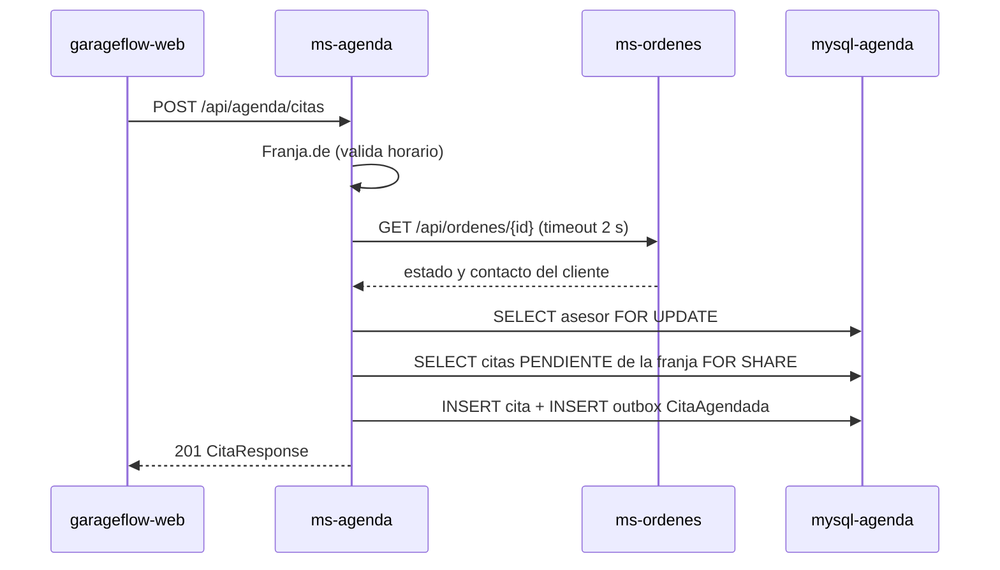

# Diseño: 03-citas

Estado: APROBADO (2026-11-12, Developer)

## Resumen

`ms-agenda` guarda asesores y citas. Para agendar, consulta la orden en `ms-ordenes` (REST, 2 s)
y después, en una transacción, bloquea la fila del asesor, cuenta sus citas `PENDIENTE` en la
franja y crea la cita solo si hay cupo (D-19). Cada cita agendada o cancelada genera un evento que
se guarda en el outbox en la misma transacción (D-07).

Cubre: REQ-1, REQ-2, REQ-3, REQ-4, REQ-5.

## Decisiones aplicadas

- D-03: `ms-agenda` es dueño de citas, asesores y cupos; guarda una copia del contacto del
  cliente.
- D-06: la única llamada REST entre microservicios, con timeout de 2 s.
- D-07: outbox.
- D-19: bloqueo de la fila del asesor, sin tabla de cupos.
- D-21: Spring Data JPA con Hibernate; los bloqueos se piden con `@Lock` en los repositorios.
- Convenciones de `00-base`.
- Decisiones nuevas: ninguna.

## Proyectos afectados

| Proyecto | Qué cambia | Datos propios que toca |
|---|---|---|
| `services/ms-agenda` | Dominio, caso de uso, API REST, cliente de `ms-ordenes`, persistencia y outbox | `asesores`, `citas`, `outbox` |

## Ubicación hexagonal

Paquete base `com.subacol.msagenda`.

| Clase | Capa | Responsabilidad |
|---|---|---|
| `Franja` | `domain` | Record con `inicio`. `de(inicio, ahora)` valida la regla de horario (`FRANJA_INVALIDA`); `delDia(fecha, ahora)` lista las franjas válidas que no empezaron |
| `Asesor` | `domain` | Record con `id`, `nombre`, `cupoPorFranja`; `tieneCupo(ocupadas)` |
| `Cita` | `domain` | `agendar(...)` (queda `PENDIENTE` y agrega `CitaAgendada`), `cancelar(motivo, ahora)` (`CITA_NO_PENDIENTE` si no está `PENDIENTE`; agrega `CitaCancelada`), `accionesPermitidas()` (`CANCELAR` si está `PENDIENTE`), `reconstituir`, `extraerEventos` |
| `TipoCita`, `EstadoCita`, `MotivoCancelacion` | `domain` | Enums: `TRAER`/`RECOGER`; `PENDIENTE`/`CANCELADA`; `MANUAL`/`CIERRE_ORDEN` |
| `CitaAgendada`, `CitaCancelada` | `domain` | Eventos de dominio (records) |
| `Disponibilidad` | `domain` | Record: `asesorId`, `asesorNombre`, `franjaInicio`, `cupo`, `ocupadas`, `libres` |
| `AgendaUseCase` | `application.port.in` | `asesores`, `disponibilidad(fecha)`, `agendar(comando)`, `cancelar(citaId)`, `citasDeOrden(ordenId)` |
| `AgendarCitaComando` | `application.port.in` | Record: `ordenId`, `asesorId`, `franjaInicio`, `tipo` |
| `OrdenesConsulta`, `OrdenInfo` | `application.port.out` | `Optional<OrdenInfo> obtener(ordenId)`; `OrdenInfo` con `estado`, `clienteNombre`, `clienteTelefono` |
| `AsesorRepository` | `application.port.out` | `listar()`, `buscarYBloquear(id)` |
| `CitaRepository`, `Ocupacion` | `application.port.out` | `guardar(cita)`, `Optional<Integer> asesorDeCita(citaId)`, `Optional<Cita> buscarParaActualizar(citaId)` (bloquea la cita y lee su estado actual), `porOrden(ordenId)`, `int contarPendientes(asesorId, franja)` (lectura con bloqueo: ve las citas confirmadas más recientes), `ocupacionDelDia(fecha)` |
| `PublicadorEventos` | `application.port.out` | `publicar(List<Object> eventos)` |
| `AgendaService` | `application.service` | Implementa el caso de uso |
| `AgendaController` | `adapter.in.web` | `/api/agenda` |
| `AgendarCitaRequest`, `CitaResponse`, `AsesorResponse`, `DisponibilidadResponse` | `adapter.in.web` | DTO |
| `OrdenesRestClient`, `OrdenRemotaV1` | `adapter.out.http` | `RestClient` contra `ms-ordenes` con timeouts de 2 s |
| `AsesorEntity`, `CitaEntity` | `adapter.out.persistence` | Entidades JPA de `asesores` y `citas` |
| `AsesorJpaRepository` | `adapter.out.persistence` | `findAllByOrderByIdAsc()`; `buscarParaActualizar(id)` con `@Lock(PESSIMISTIC_WRITE)` |
| `CitaJpaRepository`, `OcupacionFila` | `adapter.out.persistence` | Métodos de la tabla "Consultas" de abajo; `OcupacionFila` es la proyección de la ocupación del día |
| `AsesorPersistenceAdapter`, `CitaPersistenceAdapter` | `adapter.out.persistence` | Implementan `AsesorRepository` y `CitaRepository`; traducen entre entidad y dominio |
| `OutboxEntity`, `OutboxJpaRepository`, `OutboxPublicador`, `OutboxRelay`, `CitaAgendadaV1`, `CitaCanceladaV1` | `adapter.out.messaging` | Outbox (convención de `00-base`) |

## Reglas del dominio

- `Franja.de(inicio, ahora)`: minutos, segundos y nanos en 0; día de lunes a sábado; hora de
  inicio entre 8 y 16; `inicio` después de `ahora`. Si no, `FRANJA_INVALIDA` (tipo `INVALIDO`).
- `Franja.delDia(fecha, ahora)`: las franjas de 08:00 a 16:00 de esa fecha que cumplen `de`; vacía
  si es domingo o si todas ya empezaron.
- `Asesor.tieneCupo(ocupadas)`: `ocupadas < cupoPorFranja`. Si no hay cupo, el caso de uso lanza
  `SIN_CUPO` (tipo `CONFLICTO`).
- `Cita.cancelar(motivo, ahora)`: solo desde `PENDIENTE`; guarda el motivo y la hora.

## Caso de uso

`agendar(comando)`, con `@Transactional`:

1. `Franja.de(franjaInicio, ahora)`.
2. `ordenes.obtener(ordenId)`: si no existe, `ORDEN_NO_ENCONTRADA` (tipo `NO_ENCONTRADO`); si
   está `CERRADA`, `ORDEN_CERRADA` (tipo `CONFLICTO`). La llamada va antes de cualquier SQL, para
   no tener la fila bloqueada durante la llamada REST.
3. `asesores.buscarYBloquear(asesorId)`: si no existe, `ASESOR_NO_ENCONTRADO`. Es la primera
   sentencia SQL de la transacción.
4. `citas.contarPendientes(asesorId, franja)` y `asesor.tieneCupo(...)`. El adaptador cuenta con
   una lectura con bloqueo (`@Lock(PESSIMISTIC_READ)`, que Hibernate traduce a `FOR SHARE`).
5. `Cita.agendar(...)` con un UUID nuevo, `guardar`, `publicar(extraerEventos())`.

Con el bloqueo del paso 3, dos reservas del mismo asesor no pueden contar a la vez. El conteo del
paso 4 es una lectura con bloqueo, que en InnoDB siempre lee las filas confirmadas más recientes:
ve las citas que creó la reserva que tenía el bloqueo antes, sin depender del nivel de
aislamiento de la transacción (REQ-2.3). Los dos bloqueos se piden en los repositorios JPA del
adaptador de persistencia.

`cancelar(citaId)`, con `@Transactional`:

1. `citas.asesorDeCita(citaId)`: si no existe, `CITA_NO_ENCONTRADA`. Lee solo el id del asesor,
   sin cargar la cita, para que la lectura con bloqueo del paso 3 traiga su estado actual.
2. `asesores.buscarYBloquear(asesorId)`.
3. `citas.buscarParaActualizar(citaId)` (`@Lock(PESSIMISTIC_WRITE)`).
4. `cita.cancelar(MANUAL, ahora)`: `CITA_NO_PENDIENTE` si ya estaba cancelada.
5. `guardar(cita)` y publica `CitaCancelada`.

El cupo se libera solo, porque el conteo considera solo las citas `PENDIENTE` (REQ-3.1).

Regla de bloqueo: toda operación que crea o cancela citas toma primero el bloqueo de la fila de su
asesor. Así una reserva y una cancelación de la misma franja no se cruzan, y MySQL no puede
terminar en un bloqueo mutuo entre ellas.

`disponibilidad(fecha)`: `Franja.delDia(fecha, ahora)` × `asesores.listar()`, con las ocupadas de
`ocupacionDelDia(fecha)`; `libres = cupo - ocupadas`, mínimo 0.

## Contratos

### REST

| Método y ruta | Entrada | Respuestas | Criterios |
|---|---|---|---|
| `GET /api/agenda/asesores` | — | 200 lista de `AsesorResponse` | REQ-1.1 |
| `GET /api/agenda/disponibilidad?fecha=AAAA-MM-DD` | `fecha` obligatoria | 200 lista de `DisponibilidadResponse`; 400 `DATOS_INVALIDOS` | REQ-1.2, REQ-1.3 |
| `POST /api/agenda/citas` | `AgendarCitaRequest` | 201 `CitaResponse`; 400 `DATOS_INVALIDOS`; 400 `FRANJA_INVALIDA`; 404 `ORDEN_NO_ENCONTRADA`; 404 `ASESOR_NO_ENCONTRADO`; 409 `ORDEN_CERRADA`; 409 `SIN_CUPO`; 503 `ORDENES_NO_DISPONIBLE` | REQ-2 |
| `GET /api/agenda/citas?ordenId={id}` | `ordenId` obligatorio | 200 lista de `CitaResponse`; 400 `DATOS_INVALIDOS` | REQ-4.1 |
| `POST /api/agenda/citas/{id}/cancelar` | — | 200 `CitaResponse`; 404 `CITA_NO_ENCONTRADA`; 409 `CITA_NO_PENDIENTE` | REQ-3 |

- `AgendarCitaRequest`: `ordenId` (texto, obligatorio), `asesorId` (número, obligatorio),
  `franjaInicio` (`LocalDateTime` ISO-8601, obligatorio), `tipo` (`TipoCita`, obligatorio). Un
  formato inválido o un tipo desconocido llega como `HttpMessageNotReadableException` →
  `DATOS_INVALIDOS`.
- `CitaResponse`: `id`, `ordenId`, `asesorId`, `franjaInicio`, `tipo`, `estado`,
  `motivoCancelacion`, `clienteNombre`, `clienteTelefono`, `creadaEn`, `accionesPermitidas`.
- `DisponibilidadResponse`: `asesorId`, `asesorNombre`, `franjaInicio`, `cupo`, `ocupadas`,
  `libres`.
- Llamada a `ms-ordenes`: `GET {app.ordenes.url}/api/ordenes/{id}` con `RestClient` y
  `SimpleClientHttpRequestFactory` (conexión y lectura de 2 s). 404 → `Optional.empty()`; cualquier
  otro error de `RestClient` (timeout, conexión rechazada, 5xx) → `ORDENES_NO_DISPONIBLE` (tipo
  `NO_DISPONIBLE`). `OrdenRemotaV1` lee `id`, `estado`, `clienteNombre`, `clienteTelefono` e ignora
  el resto. `app.ordenes.url` vale `http://localhost:8081` en `application.properties` y
  `http://ms-ordenes:8081` en `docker-compose.yml`.

### Eventos

| Evento y versión | Publica | Consume | Campos |
|---|---|---|---|
| `CitaAgendada` v1 | `ms-agenda` | `ms-notificaciones` | `eventoId`, `tipo`, `version`, `ocurridoEn`, `citaId`, `ordenId`, `asesorId`, `franjaInicio`, `tipoCita`, `clienteNombre`, `clienteTelefono` |
| `CitaCancelada` v1 | `ms-agenda` | `ms-notificaciones` | los de `CitaAgendada` y `motivo` (`MANUAL` o `CIERRE_ORDEN`) |

## Modelo de datos

`services/ms-agenda/db/init.sql`:

```sql
SET NAMES utf8mb4;

CREATE TABLE asesores (
  id              INT         NOT NULL PRIMARY KEY,
  nombre          VARCHAR(80) NOT NULL,
  cupo_por_franja INT         NOT NULL,
  CONSTRAINT ck_asesores_cupo CHECK (cupo_por_franja > 0)
);

INSERT INTO asesores (id, nombre, cupo_por_franja) VALUES (1, 'Ana Gómez', 2), (2, 'Luis Pérez', 2);

CREATE TABLE citas (
  id                 VARCHAR(36)  NOT NULL PRIMARY KEY,
  orden_id           VARCHAR(36)  NOT NULL,
  asesor_id          INT          NOT NULL,
  franja_inicio      DATETIME(3)  NOT NULL,
  tipo               VARCHAR(10)  NOT NULL,
  estado             VARCHAR(12)  NOT NULL,
  motivo_cancelacion VARCHAR(20)  NULL,
  cliente_nombre     VARCHAR(120) NOT NULL,
  cliente_telefono   VARCHAR(30)  NOT NULL,
  creada_en          DATETIME(3)  NOT NULL,
  cancelada_en       DATETIME(3)  NULL,
  CONSTRAINT fk_citas_asesor FOREIGN KEY (asesor_id) REFERENCES asesores (id),
  CONSTRAINT ck_citas_tipo CHECK (tipo IN ('TRAER','RECOGER')),
  CONSTRAINT ck_citas_estado CHECK (estado IN ('PENDIENTE','CANCELADA')),
  INDEX ix_citas_asesor_franja (asesor_id, franja_inicio, estado),
  INDEX ix_citas_orden (orden_id, estado)
);

-- outbox: igual que en ms-ordenes (spec 01)
```

Consultas:

| Operación | Método del repositorio | SQL que genera Hibernate |
|---|---|---|
| Bloquear asesor | `AsesorJpaRepository.buscarParaActualizar(id)`: `@Lock(PESSIMISTIC_WRITE)` + `@Query("select a from AsesorEntity a where a.id = :id")` | `... from asesores ... where id = ? for update` |
| Contar pendientes | `CitaJpaRepository.findByAsesorIdAndFranjaInicioAndEstado(...)` con `@Lock(PESSIMISTIC_READ)`; el adaptador cuenta la lista | `... from citas ... where ... for share` |
| Bloquear cita | `findWithLockById(id)` con `@Lock(PESSIMISTIC_WRITE)` | `... for update` |
| Asesor de una cita | `@Query("select c.asesorId from CitaEntity c where c.id = :id")` | consulta sin bloqueo |
| Ocupación del día | `@Query("select c.asesorId as asesorId, c.franjaInicio as franjaInicio, count(c) as ocupadas from CitaEntity c where c.estado = :estado and c.franjaInicio >= :desde and c.franjaInicio < :hasta group by c.asesorId, c.franjaInicio")`, con la proyección `OcupacionFila` | `group by` |
| Citas de una orden | `findByOrdenIdOrderByFranjaInicioAsc(ordenId)` | `order by franja_inicio` |

## Flujo



## Errores y casos límite

| Caso | Respuesta | Criterio |
|---|---|---|
| 6 reservas simultáneas, cupo 2 | 2 citas creadas; 4 respuestas 409 `SIN_CUPO` | REQ-2.3 |
| Franja a las 10:30, un domingo o en el pasado | 400 `FRANJA_INVALIDA` | REQ-2.4 |
| `ms-ordenes` caído | 503 `ORDENES_NO_DISPONIBLE`; no se crea la cita | REQ-2.8 |
| Cancelar dos veces la misma cita | La segunda vez, 409 `CITA_NO_PENDIENTE` | REQ-3.2 |
| Dos cancelaciones simultáneas de la misma cita | La segunda espera el bloqueo del asesor, lee la cita ya `CANCELADA` y responde 409 `CITA_NO_PENDIENTE` sin publicar evento | REQ-3.2 |
| La orden se cierra mientras se agenda | La cita puede quedar `PENDIENTE` (riesgo aceptado en D-06) | — |

## Estrategia de pruebas

Pruebas de dominio (`FranjaTest`, `AsesorTest`, `CitaTest`) y de caso de uso (`AgendaServiceTest`,
con puertos falsos en memoria y un `Clock` fijo), dentro de la construcción de la imagen.

| Criterio | Prueba | Tipo |
|---|---|---|
| REQ-1.1 | `scripts/prueba-cupo.ps1` lee los 2 asesores con su cupo | manual |
| REQ-1.2 | `FranjaTest`: "REQ-1.2 delDia devuelve las franjas que no empezaron, de 08:00 a 16:00"; `AgendaServiceTest`: "REQ-1.2 disponibilidad resta las citas pendientes del cupo" | dominio, caso de uso |
| REQ-1.3 | `FranjaTest`: "REQ-1.3 un domingo o una fecha pasada no tiene franjas" | dominio |
| REQ-2.1 | `AgendaServiceTest`: "REQ-2.1 agendar con cupo crea la cita PENDIENTE con el contacto del cliente" | caso de uso |
| REQ-2.2 | `AsesorTest`: "REQ-2.2 con las ocupadas iguales al cupo no hay cupo"; `AgendaServiceTest`: "REQ-2.2 sin cupo responde SIN_CUPO" | dominio, caso de uso |
| REQ-2.3 | `AgendaServiceTest`: "REQ-2.3 bloquea al asesor antes de contar sus citas" (los puertos falsos registran el orden de las llamadas); `scripts/prueba-cupo.ps1`: 6 reservas simultáneas para un asesor con cupo 2 → 2 creadas y 4 `SIN_CUPO`; `@Lock(PESSIMISTIC_WRITE)` en `buscarParaActualizar` y `@Lock(PESSIMISTIC_READ)` en el conteo | caso de uso, manual, revisión estática |
| REQ-2.4 | `FranjaTest`: "REQ-2.4 una franja que no empieza en punto, fuera de horario, en domingo o pasada es rechazada" | dominio |
| REQ-2.5 | `AgendaServiceTest`: "REQ-2.5 una orden inexistente responde ORDEN_NO_ENCONTRADA" | caso de uso |
| REQ-2.6 | `AgendaServiceTest`: "REQ-2.6 una orden CERRADA responde ORDEN_CERRADA" | caso de uso |
| REQ-2.7 | `AgendaServiceTest`: "REQ-2.7 un asesor inexistente responde ASESOR_NO_ENCONTRADO" | caso de uso |
| REQ-2.8 | `AgendaServiceTest`: "REQ-2.8 si ms-ordenes no responde no se crea la cita"; a mano: `docker compose stop ms-ordenes` y agendar → 503 | caso de uso, manual |
| REQ-2.9 | `scripts/prueba-cupo.ps1` envía `tipo` = `LAVAR` → 400 `DATOS_INVALIDOS` | manual |
| REQ-3.1 | `CitaTest`: "REQ-3.1 cancelar una cita PENDIENTE la deja CANCELADA con motivo MANUAL"; `scripts/prueba-cupo.ps1`: después de cancelar, la franja tiene 1 libre | dominio, manual |
| REQ-3.2 | `CitaTest`: "REQ-3.2 cancelar una cita CANCELADA es rechazado con CITA_NO_PENDIENTE" | dominio |
| REQ-3.3 | `AgendaServiceTest`: "REQ-3.3 cancelar una cita inexistente responde CITA_NO_ENCONTRADA" | caso de uso |
| REQ-4.1 | `scripts/prueba-cupo.ps1` lista las citas de la orden; la consulta es `findByOrdenIdOrderByFranjaInicioAsc` | manual, revisión estática |
| REQ-4.2 | `CitaTest`: "REQ-4.2 una cita PENDIENTE permite CANCELAR y una CANCELADA no" | dominio |
| REQ-5.1 | `CitaTest`: "REQ-5.1 agendar genera CitaAgendada con sus datos" | dominio |
| REQ-5.2 | `CitaTest`: "REQ-5.2 cancelar genera CitaCancelada con el motivo" | dominio |
| REQ-5.3 | `@Transactional` en el caso de uso; `OutboxPublicador` guarda con un repositorio JPA dentro de esa transacción | revisión estática |

## Riesgos

- El bloqueo es por asesor: sus reservas se atienden en fila aunque sean de franjas distintas
  (D-19).
- Si alguien cambia el conteo por una lectura sin bloqueo, podría quedar desactualizado y superar
  el cupo. Mitigación: la prueba del orden de llamadas, la revisión estática de los `@Lock` y
  `scripts/prueba-cupo.ps1`.

## Cambios

- 2026-11-12: persistencia con Spring Data JPA y Hibernate (D-21), pedida por el Developer al
  aprobar; la cancelación lee la cita con bloqueo en lugar del `UPDATE` condicional.
