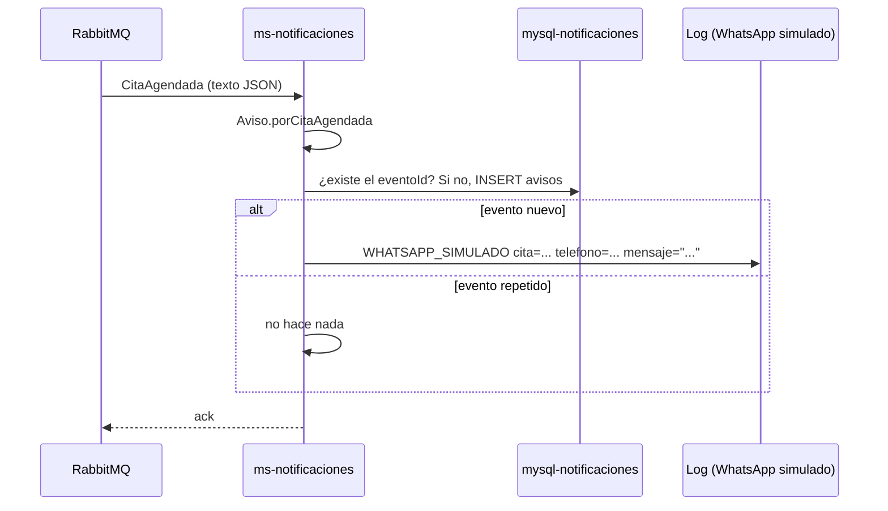

# Diseño: 04-avisos-whatsapp

Estado: APROBADO (2026-11-12, Developer)

## Resumen

`ms-notificaciones` escucha `CitaAgendada` y `CitaCancelada`, arma el aviso en el dominio
(`Aviso`), lo registra por `eventoId` para no repetirlo y lo envía por el puerto `Notificador`.
El adaptador de hoy, `WhatsAppLogNotificador`, escribe el WhatsApp en el log (D-05).

Cubre: REQ-1.

## Decisiones aplicadas

- D-05: puerto `Notificador`; el log reemplaza al proveedor real.
- D-07: consumidor idempotente por `eventoId`.
- D-21: Spring Data JPA.
- Convenciones de `00-base`: colas con DLQ y reintentos.
- Decisiones nuevas: ninguna.

## Proyectos afectados

| Proyecto | Qué cambia | Datos propios que toca |
|---|---|---|
| `services/ms-notificaciones` | Dominio, caso de uso, consumidores, notificador por log, persistencia | `avisos` |

## Ubicación hexagonal

Paquete base `com.subacol.msnotificaciones`.

| Clase | Capa | Responsabilidad |
|---|---|---|
| `Aviso` | `domain` | Record con `eventoId`, `citaId`, `ordenId`, `tipoEvento`, `telefono`, `mensaje`, `estado`. `porCitaAgendada(eventoId, cita)` y `porCitaCancelada(eventoId, cita, motivo)` arman el aviso; `debeEnviarse()` devuelve `true` solo si el estado es `ENVIADO` |
| `DatosCita` | `domain` | Record con `citaId`, `ordenId`, `tipoCita`, `franjaInicio`, `clienteNombre`, `clienteTelefono`. Rechaza los vacíos con `EVENTO_INVALIDO` (tipo `INVALIDO`) |
| `TipoEvento`, `EstadoAviso`, `MotivoCancelacion`, `TipoCita` | `domain` | Enums: `CITA_AGENDADA`/`CITA_CANCELADA`; `ENVIADO`/`OMITIDO`; `MANUAL`/`CIERRE_ORDEN`; `TRAER`/`RECOGER` (con el texto "traer" o "recoger") |
| `AvisosUseCase` | `application.port.in` | `citaAgendada(eventoId, cita)`, `citaCancelada(eventoId, cita, motivo)` |
| `AvisoRepository` | `application.port.out` | `boolean registrarSiEsNuevo(Aviso)` |
| `Notificador` | `application.port.out` | `void enviar(Aviso)` |
| `AvisosService` | `application.service` | Con `@Transactional`: arma el aviso, lo registra y, si es nuevo y `debeEnviarse()`, lo envía. Si el envío falla, la transacción se deshace y el mensaje se reintenta |
| `CitasListener` | `adapter.in.messaging` | Dos `@RabbitListener`: `notificaciones.cita-agendada` y `notificaciones.cita-cancelada`; leen el texto con `JsonMapper` |
| `CitaAgendadaV1`, `CitaCanceladaV1` | `adapter.in.messaging` | DTO de los eventos, con `@JsonIgnoreProperties(ignoreUnknown = true)` |
| `WhatsAppLogNotificador` | `adapter.out.notification` | Escribe `WHATSAPP_SIMULADO cita=<citaId> telefono=<telefono> mensaje="<mensaje>"` con SLF4J en nivel INFO |
| `AvisoEntity` | `adapter.out.persistence` | `@Entity` de `avisos`; el id es el `eventoId` |
| `AvisoJpaRepository` | `adapter.out.persistence` | `JpaRepository<AvisoEntity, String>` |
| `AvisoPersistenceAdapter` | `adapter.out.persistence` | Implementa `AvisoRepository`: si `existsById(eventoId)`, devuelve `false`; si no, guarda y devuelve `true` |
| `RabbitConfig` | `config` | Agrega las 2 colas, sus DLQ y sus enlaces (`cita.agendada`, `cita.cancelada`) |

## Mensajes

- Fecha con `dd/MM/yyyy` y hora con `HH:mm`, a partir de `franjaInicio`.
- `CitaAgendada`: `Hola <clienteNombre>, tu cita para <traer|recoger> tu vehículo quedó agendada el <fecha> a las <hora>.`
- `CitaCancelada` con motivo `MANUAL`: `Hola <clienteNombre>, tu cita del <fecha> a las <hora> fue cancelada.`
- `CitaCancelada` con motivo `CIERRE_ORDEN`: el aviso queda `OMITIDO`, sin mensaje, y
  `debeEnviarse()` devuelve `false` (regla del spec `05-cierre-orden`, REQ-2.1).

## Contratos

### REST

Ninguno. `ms-notificaciones` solo expone `/actuator/health` (spec `00-base`).

### Eventos

| Evento y versión | Publica | Consume | Campos que usa |
|---|---|---|---|
| `CitaAgendada` v1 | `ms-agenda` | `ms-notificaciones` | `eventoId`, `citaId`, `ordenId`, `tipoCita`, `franjaInicio`, `clienteNombre`, `clienteTelefono` |
| `CitaCancelada` v1 | `ms-agenda` | `ms-notificaciones` | los mismos y `motivo` |

## Modelo de datos

`services/ms-notificaciones/db/init.sql`:

```sql
SET NAMES utf8mb4;

CREATE TABLE avisos (
  evento_id     VARCHAR(36)  NOT NULL PRIMARY KEY,
  cita_id       VARCHAR(36)  NOT NULL,
  orden_id      VARCHAR(36)  NOT NULL,
  tipo_evento   VARCHAR(20)  NOT NULL,
  telefono      VARCHAR(30)  NOT NULL,
  mensaje       VARCHAR(500) NULL,
  estado        VARCHAR(10)  NOT NULL,
  registrado_en DATETIME(3)  NOT NULL,
  CONSTRAINT ck_avisos_estado CHECK (estado IN ('ENVIADO','OMITIDO'))
);
```

La clave primaria `evento_id` hace que un evento repetido no se registre ni se envíe dos veces.

## Flujo



## Errores y casos límite

| Caso | Respuesta | Criterio |
|---|---|---|
| Evento repetido | No se registra ni se envía de nuevo | REQ-1.3 |
| Evento sin teléfono o que no se puede leer | `EVENTO_INVALIDO`; 3 intentos y el mensaje pasa a la `.dlq` | REQ-1.5 |
| La base de notificaciones está caída | 3 intentos y el mensaje pasa a la `.dlq` | REQ-1.5 |

## Estrategia de pruebas

| Criterio | Prueba | Tipo |
|---|---|---|
| REQ-1.1 | `AvisoTest`: "REQ-1.1 una cita agendada arma el mensaje con el tipo, la fecha y la hora"; `AvisosServiceTest`: "REQ-1.1 una cita agendada se envía al teléfono del cliente"; `scripts/prueba-cierre.ps1` (spec `05`) encuentra la línea `WHATSAPP_SIMULADO` de la cita | dominio, caso de uso, manual |
| REQ-1.2 | `AvisoTest`: "REQ-1.2 una cancelación MANUAL arma el aviso de cancelación"; `scripts/prueba-cierre.ps1` encuentra el aviso de la cita cancelada a mano | dominio, manual |
| REQ-1.3 | `AvisosServiceTest`: "REQ-1.3 un evento repetido avisa una sola vez" | caso de uso |
| REQ-1.4 | `AvisosServiceTest`: "REQ-1.4 el aviso enviado queda registrado como ENVIADO" | caso de uso |
| REQ-1.5 | `AvisoTest`: "REQ-1.5 una cita sin teléfono es rechazada con EVENTO_INVALIDO"; las 2 colas declaran su DLQ | dominio, revisión estática |

## Riesgos

- Con un proveedor real, el envío puede fallar después de registrar el aviso. Hoy el envío está
  dentro de la transacción y un fallo la deshace; con un proveedor real habría que revisarlo.

## Cambios

- 2026-11-12: persistencia con Spring Data JPA y Hibernate (D-21), pedida por el Developer al
  aprobar.
