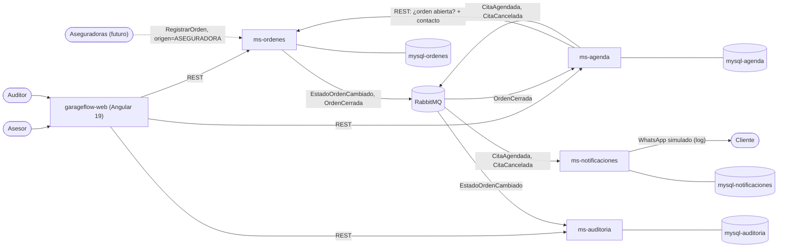

# DECISIONES

Registro de decisiones de arquitectura del proyecto. Cada frontera trazada, las alternativas
descartadas y las propuestas de la IA que se rechazaron. Las entradas se agregan; no se borran.
Si una decisión cambia, se agrega una nueva que reemplaza a la anterior (`Reemplaza: D-xx`).

---

## Contexto

- Problema: un taller automotriz recibe vehículos de clientes particulares y de aseguradoras, y
  hoy lo maneja con Excel y WhatsApp. El sistema debe registrar órdenes de servicio, moverlas por
  estados (reabrir siempre con motivo), agendar citas con cupo por asesor y franja, avisar al
  cliente por WhatsApp, cancelar las citas al cerrar la orden sin avisarle, y guardar un historial
  de cambios de estado que nadie pueda alterar. Las órdenes de aseguradoras grandes llegarán
  después por integración.
- Restricciones: Angular, Java con microservicios, arquitectura hexagonal, `docker compose up`.
  WhatsApp simulado con un log.
- Tiempo / prioridad: 1 día. Lo más simple que funcione. Primero las reglas difíciles (estados,
  auditoría, cupo, cierre sin aviso); después la interfaz.
- Stack: Angular 19.2, Spring Boot 4.1.2, Java 21, MySQL 8.4, RabbitMQ 4 y Spring Data JPA con
  Hibernate 7.4 (D-21).
- Proyecto: `c:\repos_cobis\Prueba`, con los esqueletos que creó el Developer (D-16).
- Método: desarrollo guiado por specs (D-15), aprobados por lotes (D-20). El orden está en
  "Plan de specs".

## Propuestas de arquitectura

Se evaluaron 4 propuestas. El Developer eligió **P2** el 2026-11-12. Los motivos para descartar
las demás están en R-01, R-02 y R-03.

### Base común (las 4 propuestas)

- Stack: Angular 19, Spring Boot 4, Java 21 y `docker compose up`. La base de datos propuesta era
  PostgreSQL; el Developer la cambió por MySQL (D-12, R-04).
- Cada microservicio tiene arquitectura hexagonal y su propia base de datos.
- La orden avanza por estados con reglas en el dominio. Reabrirla exige un motivo.
- El cupo de citas por asesor y franja lo controla la base de datos de agenda, para que dos
  reservas simultáneas no superen el límite.
- Al cerrar una orden, sus citas se cancelan con motivo `CIERRE_ORDEN` y no se avisa al cliente.
- La auditoría solo admite inserciones. La base de datos rechaza modificaciones y borrados.
- Las órdenes de aseguradoras entrarán después por el mismo caso de uso `RegistrarOrden`.
  Hoy solo se deja listo ese punto de entrada.
- WhatsApp se simula escribiendo en el log.
- Cada microservicio guarda el cambio y el aviso pendiente en la misma transacción (outbox), para
  no perder ninguno.

### P1 — 3 microservicios + RabbitMQ (descartada, ver R-01)

- Microservicios: `ms-ordenes` (incluye la auditoría), `ms-agenda` y `ms-notificaciones`.
- A favor: es la más rápida de construir.
- En contra: la auditoría comparte base de datos con el microservicio que cambia los estados.

### P2 — 4 microservicios + RabbitMQ (elegida, ver D-01)

- Microservicios: los de P1 más `ms-auditoria`.
- A favor: el microservicio que cambia los estados no tiene acceso a la base de datos de auditoría.
- En contra: hay un microservicio más, y el registro de auditoría aparece unos segundos después
  del cambio.

### P3 — 6 microservicios + API gateway (descartada, ver R-02)

- Microservicios: los de P2 más `ms-clientes`, `ms-integracion-aseguradoras` y un gateway.
- A favor: muestra el dominio completo.
- En contra: no cabe en 1 día. `ms-clientes` no tiene reglas propias. La integración con
  aseguradoras se pidió para más adelante.

### P4 — 4 microservicios sin RabbitMQ (descartada, ver R-03)

- Microservicios: los de P2, comunicados solo por REST.
- A favor: menos infraestructura.
- En contra: si un microservicio está caído, el que lo llama falla o pierde el aviso. Los
  reintentos se programan a mano.

### Comparación

| | P1 | P2 | P3 | P4 |
|---|---|---|---|---|
| Microservicios | 3 | 4 | 6 + gateway | 4 |
| Comunicación | Eventos | Eventos | Eventos + gateway | REST |
| Auditoría en microservicio propio | No | Sí | Sí | Sí |
| ¿Cabe en 1 día? (estimado) | Sí | Justo | No | Sí |
| Resultado | Descartada | **Elegida** | Descartada | Descartada |

## Mapa de microservicios

| Microservicio | Responsabilidad | Datos que posee | Expone | Consume |
|---|---|---|---|---|
| `ms-ordenes` | Registrar órdenes y hacerlas avanzar por sus estados | Orden: cliente, vehículo, aseguradora, trabajo a realizar y estado actual | REST: registrar, cambiar estado, reabrir, consultar. Eventos: `EstadoOrdenCambiado`, `OrdenCerrada` | Nada |
| `ms-agenda` | Agendar y cancelar citas sin superar el cupo | Citas, franjas, asesores y su cupo por franja. Copia del contacto del cliente (dueño: `ms-ordenes`) | REST: disponibilidad, agendar, cancelar, consultar. Eventos: `CitaAgendada`, `CitaCancelada` | REST a `ms-ordenes` al agendar. Evento `OrdenCerrada` |
| `ms-auditoria` | Guardar y mostrar el historial de cambios de estado | Historial de cambios de estado (solo inserción) | REST: historial de una orden | Evento `EstadoOrdenCambiado` |
| `ms-notificaciones` | Avisar al cliente por WhatsApp (simulado con log) | Avisos enviados u omitidos | Nada; el aviso se ve en el log | Eventos `CitaAgendada`, `CitaCancelada` |

Infraestructura: RabbitMQ y un MySQL por microservicio. El frontend `garageflow-web` llama directo
a cada microservicio (D-13).

## Eventos

Todos llevan `eventoId`, `tipo` (el nombre del evento), `version` y `ocurridoEn`. Los campos
exactos de cada uno están en el diseño del spec que lo publica.

| Evento | Lo publica | Lo consume | Datos principales |
|---|---|---|---|
| `EstadoOrdenCambiado` | `ms-ordenes` | `ms-auditoria` | `ordenId`, `estadoAnterior`, `estadoNuevo`, `motivo`, `usuario`, `origen` |
| `OrdenCerrada` | `ms-ordenes` | `ms-agenda` | `ordenId`, `usuario` |
| `CitaAgendada` | `ms-agenda` | `ms-notificaciones` | `citaId`, `ordenId`, `asesorId`, `franjaInicio`, `tipoCita` (`TRAER` o `RECOGER`), `clienteNombre`, `clienteTelefono` |
| `CitaCancelada` | `ms-agenda` | `ms-notificaciones` | los de `CitaAgendada` y `motivo` (`MANUAL` o `CIERRE_ORDEN`) |

## Diagrama de contexto



## Proyectos

El Developer creó los proyectos en `c:\repos_cobis\Prueba` el 2026-11-12, y se usan tal como están
(D-16). Desde D-27 la carpeta es `c:\repos_cobis\garageflow`. Esta es la estructura; los
elementos marcados los agregan los specs:

```text
c:\repos_cobis\garageflow\
├── .kiro/specs/            specs del proyecto, uno por capacidad (ver "Plan de specs")
├── garageflow-web/         Angular 19.2, con su propio repositorio git
├── seed/                   datos de ejemplo (D-26)
├── garageflow-services/
│   ├── ms-ordenes/         Maven
│   ├── ms-agenda/          Maven (era Gradle, ver D-22)
│   ├── ms-auditoria/       Maven
│   └── ms-notificaciones/  Maven
├── scripts/                pruebas contra el sistema levantado (las agregan los specs)
├── docker-compose.yml      lo agrega 00-base
├── .env.example            lo agrega 00-base
├── DECISIONES.md
└── README.md               lo agrega 00-base
```

### Microservicios

Los 4 usan Spring Boot 4.1.2, Group `com.subacol` y Java 21. Los esqueletos solo traen
`spring-boot-starter` y `spring-boot-starter-test`; el spec `00-base` agrega lo demás.

| Microservicio | Construcción | Paquete base | Puerto | Base de datos |
|---|---|---|---|---|
| `ms-ordenes` | Maven | `com.subacol.msordenes` | 8081 | `ordenes_db` en `mysql-ordenes` |
| `ms-agenda` | Maven (era Gradle 9.8.2, ver D-22) | `com.subacol.msagenda` | 8082 | `agenda_db` en `mysql-agenda` |
| `ms-auditoria` | Maven | `com.subacol.msauditoria` | 8083 | `auditoria_db` en `mysql-auditoria` |
| `ms-notificaciones` | Maven | `com.subacol.msnotificaciones` | 8084 | `notificaciones_db` en `mysql-notificaciones` |

Cambios que hace `00-base` en los esqueletos:

- Agrega `spring-boot-starter-webmvc`, `spring-boot-starter-validation`,
  `spring-boot-starter-data-jpa`, `spring-boot-starter-amqp`, `spring-boot-starter-actuator` y
  `com.mysql:mysql-connector-j` (los nombres que genera start.spring.io para Boot 4.1.2).
- Sube `ms-notificaciones` de Java 17 a Java 21, como los demás.
- Quita la prueba generada `contextLoads` de cada microservicio: necesita MySQL y RabbitMQ y haría
  fallar la construcción dentro de Docker (D-18).
- En `docker-compose.yml`, cada microservicio usa su nombre como nombre de contenedor. Por
  ejemplo, `ms-agenda` llama a `http://ms-ordenes:8081`.

### Frontend

`garageflow-web`: Angular 19.2 con Tailwind CSS 4 (D-23). Se creó con SSR, que nunca se usó y
se quitó con D-24; ahora es una aplicación de navegador. Corre con `ng serve` en el
puerto 4200 (D-13).

### Infraestructura

- `rabbitmq`: RabbitMQ 4 con consola web en `http://localhost:15672`.
- `mysql-ordenes`, `mysql-agenda`, `mysql-auditoria` y `mysql-notificaciones`: MySQL 8.4. Cada
  uno ejecuta los scripts de la carpeta `db/` de su microservicio (D-12).

---

## Decisiones

### D-01 — Arquitectura: 4 microservicios comunicados por eventos (P2)

- Decisión: 4 microservicios (`ms-ordenes`, `ms-agenda`, `ms-auditoria`, `ms-notificaciones`),
  cada uno con su base de datos, comunicados por eventos a través de RabbitMQ. Hay una sola
  llamada REST entre microservicios: `ms-agenda` consulta a `ms-ordenes` al agendar.
- Motivo: es la opción más simple en la que el microservicio que cambia los estados no puede
  tocar el registro de auditoría, y cabe en 1 día.
- Alternativas descartadas: P1 (R-01), P3 (R-02) y P4 (R-03).
- Consecuencias / riesgos: 10 contenedores (4 microservicios, 4 MySQL, RabbitMQ y el frontend).
  La auditoría y los avisos llegan unos segundos después del cambio.
- Estado: ACEPTADA. La eligió el Developer; era también la recomendación de la IA.

### D-02 — Frontera: `ms-ordenes`

- Decisión: `ms-ordenes` es dueño de la orden de servicio: cliente, vehículo, aseguradora (si
  aplica), trabajo a realizar y estado actual. Cliente y vehículo se guardan como datos de la orden.
- Reglas del dominio: la orden sigue `REGISTRADA → EN_DIAGNOSTICO → EN_REPARACION → REPARADA →
  CERRADA`. Reabrir lleva la orden de `REPARADA` o `CERRADA` a `EN_REPARACION` y exige un motivo.
  Cualquier otra transición se rechaza.
- Motivo: la orden y su estado cambian juntos y por las mismas razones. Cliente y vehículo no
  tienen reglas propias en el enunciado.
- Alternativas descartadas:
  - `ms-clientes` aparte: solo guardaría datos, sin reglas (ver R-02).
- Supuesto: la lista de estados y desde dónde se reabre. El enunciado no los fija.
- Estado: ACEPTADA. La lista de estados está pendiente de confirmar.

### D-03 — Frontera: `ms-agenda`

- Decisión: `ms-agenda` es dueño de las citas (traer o recoger el vehículo), de las franjas
  horarias y del cupo de cada asesor por franja. Cada cita guarda solo el id de su orden.
- Motivo: el cupo se cuenta por asesor y franja, sumando citas de órdenes distintas. Es un
  calendario con su propia regla de concurrencia (D-09), distinto del avance de una reparación.
- Alternativas descartadas:
  - Citas dentro de `ms-ordenes`: tendría dos responsabilidades que cambian por motivos
    distintos, el avance de la reparación y el calendario de los asesores.
- Supuestos:
  - Los asesores y su cupo por franja se cargan como datos iniciales en el `db/init.sql` de
    `ms-agenda`.
  - Las franjas son de 1 hora dentro del horario laboral; la duración es configurable.
  - `ms-agenda` guarda una copia del nombre y el teléfono del cliente, tomada de `ms-ordenes` al
    agendar, para incluirla en sus eventos. El dueño de ese dato sigue siendo `ms-ordenes`.
- Estado: ACEPTADA. Los supuestos están pendientes de confirmar.

### D-04 — Frontera: `ms-auditoria`

- Decisión: `ms-auditoria` es dueño del historial de cambios de estado de las órdenes: quién,
  cuándo, estado anterior, estado nuevo y motivo. Lo recibe por el evento `EstadoOrdenCambiado`
  y solo permite consultarlo.
- Motivo: el enunciado pide que nadie pueda alterar el registro. Con el historial en otro
  microservicio, `ms-ordenes` no tiene credenciales para tocarlo.
- Alternativas descartadas:
  - Historial dentro de `ms-ordenes` (P1, ver R-01).
- Consecuencias / riesgos: el registro aparece unos segundos después del cambio, lo que tarde
  el outbox (D-07).
- Estado: ACEPTADA.

### D-05 — Frontera: `ms-notificaciones`

- Decisión: `ms-notificaciones` avisa al cliente por WhatsApp cuando se agenda o se cancela una
  cita. Escucha los eventos de `ms-agenda`. El envío pasa por un puerto `Notificador`; hoy su
  adaptador escribe en el log.
- Motivo: un proveedor de WhatsApp puede fallar o tardar. Separado, nunca frena el agendamiento,
  y la regla de cuándo no avisar queda en un solo lugar.
- Alternativas descartadas:
  - Avisar desde `ms-agenda` con su propio adaptador: menos piezas, pero una falla del proveedor
    afectaría a `ms-agenda`, y cada aviso futuro (por ejemplo, "su vehículo está listo")
    obligaría a repetir el adaptador en otro microservicio.
- Consecuencias / riesgos: guarda cada aviso, enviado u omitido, con el id del evento. Así no lo
  repite si RabbitMQ entrega el mismo evento dos veces.
- Estado: ACEPTADA.

### D-06 — Comunicación: eventos para los hechos, REST solo para validar al agendar

- Decisión:
  - Lo que ya pasó viaja como evento por RabbitMQ (ver la tabla "Eventos").
  - La única llamada REST entre microservicios es la de `ms-agenda` a `ms-ordenes` al agendar:
    confirma que la orden existe y no está cerrada, y obtiene el contacto del cliente. Timeout de
    2 s; si `ms-ordenes` no responde, la cita no se crea y se devuelve un error claro.
- Motivo:
  - RabbitMQ guarda cada evento en una cola hasta que el consumidor lo procesa. Si `ms-agenda` o
    `ms-auditoria` están caídos, cerrar una orden igual funciona.
  - El que publica no sabe quién escucha. Auditar citas más adelante es agregar una cola, sin
    tocar `ms-agenda`.
  - Agendar sí necesita una respuesta inmediata: no se puede dar una cita a una orden que no existe.
- Alternativas descartadas:
  - Solo REST (P4, ver R-03).
  - Kafka: más pesado en `docker compose`, y aquí no hace falta reprocesar eventos antiguos.
  - Copia en `ms-agenda` de las órdenes abiertas, alimentada por eventos: evita la llamada REST,
    pero pide más eventos y más código. Queda para después.
- Consecuencias / riesgos: si la orden se cierra justo mientras se agenda una cita, esa cita
  podría quedar pendiente. Se acepta: la ventana es de milisegundos y el evento de cierre tarda
  hasta un segundo en salir.
- Estado: ACEPTADA.

### D-07 — No perder eventos: outbox y consumidores idempotentes

- Decisión: `ms-ordenes` y `ms-agenda` guardan cada evento en una tabla `outbox` de su propia
  base de datos, en la misma transacción que el cambio. Un proceso programado publica las filas
  pendientes cada segundo y las marca como enviadas. Cada consumidor guarda el id de los eventos
  que ya procesó y descarta los repetidos.
- Motivo: si el microservicio guardara el cambio y después publicara, una caída entre los dos
  pasos dejaría un cambio sin evento: una orden cerrada con citas que nunca se cancelan, o un
  cambio de estado sin auditoría.
- Alternativas descartadas:
  - Publicar directo después de guardar: puede perder eventos.
  - Leer el binlog de MySQL con Debezium: más contenedores y configuración de los que justifica
    1 día.
- Consecuencias / riesgos: un evento puede llegar más de una vez; por eso los consumidores
  descartan los repetidos.
- Estado: ACEPTADA.

### D-08 — Cierre de orden: cancelar citas sin avisar al cliente

- Decisión: al recibir `OrdenCerrada`, `ms-agenda` cancela las citas pendientes de esa orden con
  motivo `CIERRE_ORDEN` y publica `CitaCancelada` con ese motivo. `ms-notificaciones` no avisa
  cuando el motivo es `CIERRE_ORDEN` y registra el aviso como omitido.
- Motivo: el dato que decide si se avisa viene en el evento que publica `ms-agenda`. El
  consumidor no tiene que adivinarlo.
- Alternativas descartadas:
  - Que `ms-agenda` no publique el evento en ese caso: ocultaría un hecho real a otros
    consumidores, por ejemplo a una futura auditoría de citas.
  - Que `ms-notificaciones` pregunte a `ms-ordenes` si la orden está cerrada: agrega una
    dependencia, y la respuesta puede no corresponder al momento de la cancelación, por ejemplo
    si la orden ya se reabrió.
- Estado: ACEPTADA.

### D-09 — Cupo por asesor y franja: lo controla la base de datos de `ms-agenda`

- Decisión: tabla `cupo_franja` (asesor_id, franja_inicio, capacidad, ocupadas). Para reservar,
  `ms-agenda` ejecuta:

  ```sql
  UPDATE cupo_franja SET ocupadas = ocupadas + 1
  WHERE asesor_id = ? AND franja_inicio = ? AND ocupadas < capacidad
  ```

  Si modifica 1 fila, hay cupo. Si modifica 0, la franja está llena y se responde 409. Cancelar
  una cita libera el cupo. La fila se crea la primera vez que se usa esa franja.
- Motivo: InnoDB bloquea la fila hasta el fin de la transacción, y la segunda reserva vuelve a
  evaluar la condición con el valor ya actualizado. Dos reservas simultáneas no pueden tomar el
  último cupo.
- Alternativas descartadas:
  - Contar las citas y después insertar: dos solicitudes simultáneas pueden pasar la
    verificación y superar el límite.
  - `SELECT ... FOR UPDATE` y después insertar: también funciona, pero pide más código y
    transacciones más largas.
- Consecuencias / riesgos: se demuestra con una prueba de reservas concurrentes.
- Estado: REEMPLAZADA por D-19.

### D-10 — Auditoría inalterable: la protege la base de datos

- Decisión: el `db/init.sql` de `ms-auditoria` (D-12) crea:
  - la tabla del historial, con el id del evento como clave única, para no duplicar un registro
    si el evento llega dos veces;
  - triggers `BEFORE UPDATE` y `BEFORE DELETE` que rechazan cualquier modificación o borrado,
    sin importar el usuario;
  - los permisos del usuario de la aplicación: solo `SELECT` e `INSERT`.
- Motivo: si la protección estuviera solo en el código, un error o un acceso directo a la base
  de datos podría alterar el registro.
- Alternativas descartadas:
  - Protección solo en el código: no cumple "sin que nadie pueda alterar ese registro".
  - Cadena de hashes entre registros: detectaría cambios hechos por un administrador, pero no
    cabe en 1 día (ver "Fuera de alcance").
- Consecuencias / riesgos: un administrador de MySQL (root) puede borrar los triggers. Se acepta
  para este alcance.
- Estado: ACEPTADA.
- Nota (spec `02-auditoria`): el usuario de la aplicación lo crea `db/usuario-app.sh`, que toma
  la contraseña de una variable de entorno, para no dejarla escrita en el repositorio.

### D-11 — Órdenes de aseguradoras: punto de entrada listo, integración después

- Decisión: el caso de uso `RegistrarOrden` recibe un campo `origen` (`ASESOR` o
  `ASEGURADORA`). Hoy solo lo llama el controlador REST que usa el asesor. La integración futura
  será otro adaptador de entrada en `ms-ordenes` que llama al mismo caso de uso.
- Motivo: el enunciado dice que esas órdenes llegarán más adelante. Con el punto de entrada
  listo, la integración no obliga a cambiar el dominio.
- Alternativas descartadas:
  - Construir ahora un microservicio de integración (P3, ver R-02): todavía no se conoce el
    formato que usará cada aseguradora.
- Estado: ACEPTADA.

### D-12 — Base de datos: MySQL 8.4, una por microservicio, creada con un script

- Decisión:
  - MySQL 8.4 LTS, un contenedor por microservicio.
  - Cada microservicio tiene un `db/init.sql` con sus tablas y datos iniciales. MySQL lo ejecuta
    como root la primera vez que arranca, cuando su volumen está vacío
    ([imagen oficial de MySQL](https://hub.docker.com/_/mysql)).
  - Hibernate no crea ni modifica tablas.
- Motivo: elección del Developer, con la consigna de que sea simple. El script no agrega
  dependencias en Java y, como corre como root, también crea los triggers y los permisos de
  auditoría (D-10).
- Alternativas descartadas:
  - PostgreSQL (R-04).
  - Flyway (R-06).
  - Que Hibernate cree las tablas: no puede crear los triggers ni los permisos de auditoría.
  - MySQL 9.7 LTS: también serviría. Se queda 8.4, la LTS con más tiempo en uso; cambiar de
    versión es cambiar la etiqueta de la imagen.
  - Una sola instancia de MySQL con un esquema por microservicio: usa menos memoria, pero todos
    dependen del mismo servidor y la frontera de datos se ve menos en `docker compose`.
- Consecuencias / riesgos:
  - Si cambia un script, hay que recrear las bases con `docker compose down -v`, que borra los
    datos. Se acepta para la demo.
  - No queda un historial versionado de cambios del esquema (ver "Fuera de alcance").
  - 4 contenedores MySQL usan más memoria que uno. Si la máquina se queda corta, se puede pasar
    a una instancia con un esquema y un usuario por microservicio.
- Estado: ACEPTADA.

### D-13 — Frontend: Angular 19 llama directo a cada microservicio

- Decisión:
  - Angular 19 con componentes standalone, en el proyecto `taller-web`.
  - En `docker compose` corre con `ng serve` en el puerto 4200.
  - El navegador llama directo a `ms-ordenes` (8081), `ms-agenda` (8082) y `ms-auditoria`
    (8083). Las URLs están en un archivo de configuración del frontend.
  - Esos 3 microservicios permiten CORS desde `http://localhost:4200`.
  - La interfaz muestra solo las acciones que permite la API y los errores que devuelve; no
    decide reglas de negocio.
- Motivo: Angular 19 es requisito del Developer, y el Developer pidió quitar nginx para
  simplificar. Sin proxy ni servidor web aparte hay una pieza menos que configurar.
- Alternativas descartadas:
  - nginx como entrada única (R-05).
  - Spring Cloud Gateway (R-02).
- Consecuencias / riesgos:
  - `ng serve` es el servidor de desarrollo de Angular: sirve para la demo, no para producción.
  - Angular 19 ya no tiene soporte oficial y no recibe parches de seguridad
    ([angular.dev](https://angular.dev/reference/releases)). La IA sugirió Angular 21; está
    pendiente de que el Developer lo confirme.
- Estado: ACEPTADA.
- Nota (D-16): el proyecto es `garageflow-web`, que el Developer creó con SSR; se usa solo el
  renderizado en el navegador.
- Nota (2026-11-12): con D-24 se quitó el SSR, y con D-23 el diseño usa Tailwind CSS 4.

### D-14 — Usuario simulado, sin autenticación

- Nota (2026-11-12): D-25 agrega los roles `ASESOR`, `AUDITOR` y `ADMIN`, también simulados, en
  la cabecera `X-Rol`.

- Decisión: en la pantalla se elige el usuario de una lista de demostración, y cada petición lo
  envía en la cabecera `X-Usuario`. `ms-ordenes` lo copia en `EstadoOrdenCambiado` y
  `ms-auditoria` lo guarda como el "quién". Las órdenes que lleguen por integración usarán como
  usuario a la aseguradora.
- Motivo: la auditoría necesita un "quién", y una autenticación real no cabe en 1 día.
- Alternativas descartadas:
  - Keycloak u otro proveedor OIDC: es lo correcto para producción, pero agrega un contenedor y
    configuración que no caben en el día.
- Consecuencias / riesgos: el "quién" no está verificado; cualquiera puede enviar otra cabecera.
  Es la primera mejora de "Fuera de alcance".
- Estado: ACEPTADA (2026-11-12, junto con los specs).

### D-15 — Método: desarrollo guiado por specs, uno por capacidad

- Decisión: cada capacidad del "Plan de specs" tiene un spec con requisitos, diseño y tareas, que
  el Developer aprueba antes de escribir código. Los specs se hacen uno a la vez, en el orden del
  plan. Cada criterio de aceptación tiene un id (`REQ-n.m`) y cada prueba cita el criterio que
  demuestra.
- Motivo: el Developer pidió un desarrollo ordenado. Con criterios numerados, la revisión compara
  el código contra lo aprobado y se ve qué prueba demuestra cada regla del enunciado.
- Alternativas descartadas:
  - Programar sin specs: más rápido al empezar, pero no hay criterios contra los que revisar.
  - Un solo spec para todo el sistema: muy grande para revisarlo de una vez, y cualquier cambio
    obliga a revisarlo entero.
  - Escribir todos los specs antes de programar: los errores de diseño aparecen tarde.
- Consecuencias / riesgos: las aprobaciones toman tiempo del día. Para ahorrarlo, el Developer
  puede aprobar juntos los tres archivos de un spec.
- Estado: ACEPTADA. La pidió el Developer.
- Nota: con D-20, los 7 specs se aprobaron juntos para que quepan en el día.

### D-16 — Proyectos: se usan los esqueletos que creó el Developer

- Decisión: el proyecto vive en `c:\repos_cobis\Prueba`, con los nombres, paquetes y
  herramientas que eligió el Developer: `services/ms-*` con Group `com.subacol`, `ms-agenda` con
  Gradle y el frontend `garageflow-web`. Reemplaza los nombres del borrador (`taller-automotriz`,
  `com.taller.*`, `taller-web`).
- Motivo: los esqueletos ya existen y compilan con Spring Boot 4.1.2; regenerarlos no aporta nada
  al reto. El Developer crea los proyectos y el workflow agrega la lógica.
- Alternativas descartadas:
  - Regenerar los proyectos con los nombres del borrador: más trabajo, sin beneficio.
  - Pasar `ms-agenda` a Maven: uniformaría la construcción, pero el Gradle generado sirve igual
    dentro de Docker.
  - Quitar el SSR de `garageflow-web`: obliga a borrar archivos generados; con
    `RenderMode.Client` basta.
- Consecuencias / riesgos: `ms-agenda` tiene un Dockerfile distinto, con Gradle.
  `ms-notificaciones` sube de Java 17 a Java 21. Solo `garageflow-web` es un repositorio git; la
  carpeta `Prueba` todavía no lo es.
- Estado: ACEPTADA (2026-11-12).
- Nota (2026-11-12): D-22 reemplaza la parte de `ms-agenda` con Gradle; ahora usa Maven.

### D-17 — Persistencia con JDBC (`JdbcClient`), sin JPA

- Decisión: los microservicios usan `spring-boot-starter-jdbc` y `JdbcClient`, con el SQL escrito
  en los adaptadores de persistencia.
- Motivo: las tablas las crean los scripts de `db/` (D-12), y las reglas que dependen de la base
  (bloqueo del cupo, cambio de estado condicional, historial de solo inserción) son SQL directo.
  JPA agregaría entidades, mapeos y configuración de Hibernate sin evitar ese SQL.
- Alternativas descartadas:
  - Spring Data JPA: una entidad JPA y un mapeo más por cada objeto de dominio.
  - Spring Data JDBC: menos código que JPA, pero sus convenciones de mapeo no ayudan con el SQL
    condicional que se necesita.
- Consecuencias / riesgos: el paso de fila a objeto se escribe a mano. Son pocas tablas.
- Estado: REEMPLAZADA por D-21. El Developer pidió JPA con Hibernate (R-07).

### D-18 — Construir y probar dentro de Docker

- Decisión: cada proyecto tiene un Dockerfile de dos etapas. La primera compila y corre las
  pruebas unitarias (Maven, Gradle o npm); la segunda solo ejecuta. `docker compose up --build`
  construye todo. Las pruebas de punta a punta son scripts PowerShell en `scripts/`, que se
  corren contra el sistema levantado.
- Motivo: el Developer pidió levantar y probar todo desde Docker. Además, su máquina tiene Java 8
  por defecto y Node 24, que Angular 19 no soporta oficialmente.
- Alternativas descartadas:
  - Compilar en la máquina y copiar el jar a la imagen: depende de lo que tenga instalado cada
    máquina.
  - Pruebas de integración con Testcontainers: necesitan Docker dentro de la construcción y no
    caben en el día.
- Consecuencias / riesgos: la primera construcción descarga dependencias y tarda varios minutos;
  las siguientes usan caché. Las pruebas del frontend no corren en Docker porque necesitan un
  navegador; se revisan a mano (spec `06-taller-web`).
- Estado: ACEPTADA (2026-11-12). El Developer pidió probar en Docker.

### D-19 — Cupo por asesor y franja: bloqueo de la fila del asesor

- Reemplaza: D-09.
- Decisión: para agendar, `ms-agenda` abre una transacción, bloquea la fila del asesor
  (`SELECT ... FROM asesores WHERE id = ? FOR UPDATE`), cuenta sus citas `PENDIENTE` en la franja
  con una lectura con bloqueo (`FOR SHARE`), que siempre ve las citas ya confirmadas, y crea la
  cita solo si el conteo es menor que su cupo. No hay tabla de cupos: los cupos libres salen de
  ese conteo.
- Motivo: con D-09, la fila de cupo de cada franja tenía que existir antes de reservar. Crearla
  en el momento con dos reservas simultáneas puede terminar en un bloqueo mutuo de MySQL, y
  crearlas por adelantado exige un proceso que genere franjas. Con el bloqueo del asesor, sus
  reservas se atienden una después de otra y el conteo siempre está al día. Además, cancelar una
  cita no tiene que descontar un contador.
- Alternativas descartadas:
  - D-09, contador por franja: ver el motivo.
  - Contar e insertar sin bloqueo: dos reservas simultáneas pueden superar el cupo.
- Consecuencias / riesgos: las reservas de un mismo asesor se atienden en fila, aunque sean de
  franjas distintas; con el volumen de un taller no se nota. Cancelar una cita también toma ese
  bloqueo, para que una reserva y una cancelación de la misma franja no terminen en un bloqueo
  mutuo de MySQL. La consulta a `ms-ordenes` se hace
  antes del bloqueo, para no retenerlo durante la llamada REST. Se demuestra con
  `scripts/prueba-cupo.ps1`, que envía reservas simultáneas.
- Con JPA (D-21), los dos bloqueos se piden con `@Lock(PESSIMISTIC_WRITE)` y
  `@Lock(PESSIMISTIC_READ)` en los repositorios; Hibernate genera `FOR UPDATE` y `FOR SHARE`.
- Estado: ACEPTADA (2026-11-12).

### D-20 — Specs por lotes para el reto de 1 día

- Decisión: los 7 specs del plan se escriben juntos y el Developer los aprueba en un solo paso.
  Después se implementan por proyecto (un paquete de tareas por microservicio y otro para el
  frontend, en paralelo) y se validan juntos con `docker compose up --build` y los scripts de
  `scripts/`. Cambia la regla "uno a la vez" de D-15; lo demás de D-15 sigue igual.
- Motivo: el Developer pidió avanzar rápido. Uno a la vez serían 7 rondas de aprobación y
  validación en un solo día.
- Alternativas descartadas:
  - Uno a la vez (D-15): más seguro, pero no cabe en el día.
  - Programar sin specs: no deja criterios contra los que revisar el código.
- Consecuencias / riesgos: un error de diseño puede afectar a varios specs antes de detectarse.
  Se mitiga con la revisión de los specs antes de aprobarlos y con el aviso `SPEC_GAP` durante la
  implementación.
- Estado: ACEPTADA (2026-11-12).

### D-21 — Persistencia con Spring Data JPA y Hibernate

- Reemplaza: D-17.
- Decisión:
  - Los microservicios usan `spring-boot-starter-data-jpa` (Hibernate 7.4). Las entidades JPA y
    los repositorios de Spring Data viven en `adapter.out.persistence`, separados de las clases del
    dominio; un adaptador implementa cada puerto de salida y traduce entre entidad y dominio.
  - Las tablas siguen saliendo de los scripts de `db/` (D-12). Hibernate no las crea: arranca con
    `spring.jpa.hibernate.ddl-auto=validate` y se detiene si una entidad no coincide con su tabla.
  - Cambios simultáneos: `@Version` en la orden (`ORDEN_MODIFICADA`). Cupo: `@Lock` en los
    repositorios de agenda (D-19).
  - El historial de auditoría se mapea con `@Immutable`, así Hibernate nunca genera un `UPDATE`
    sobre él. La protección de fondo sigue en la base de datos (D-10).
  - Los DTO de entrada se validan con Jakarta Bean Validation (`spring-boot-starter-validation`),
    y los errores salen como problem details (spec `00-base`).
- Motivo: el Developer pidió la abstracción más alta de Spring Boot. Con Spring Data JPA, las
  consultas simples son métodos derivados del nombre y Hibernate escribe el SQL.
- Alternativas descartadas:
  - `JdbcClient` (D-17, R-07).
  - Que Hibernate cree las tablas (`ddl-auto=update`): no crea triggers ni permisos, y
    `sobacol-architecture.md` §5 no permite depender de DDL automático fuera de desarrollo local.
- Consecuencias / riesgos:
  - Cada tabla tiene una entidad y un mapeo hacia el dominio.
  - Los tipos de los scripts tienen que coincidir con los que espera Hibernate: ids
    `VARCHAR(36)`, enumeraciones en `VARCHAR`, fechas `DATETIME(3)`, textos en `VARCHAR`. Si no
    coinciden, el microservicio no arranca, que es justo lo que se busca con `validate`.
- Estado: ACEPTADA (2026-11-12). La pidió el Developer.

### D-22 — `ms-agenda` se construye con Maven, como los demás

- Reemplaza: la parte de D-16 que dejaba `ms-agenda` con Gradle.
- Decisión: `ms-agenda` usa Maven, con el mismo `pom.xml`, el mismo wrapper (`mvnw`) y el mismo
  Dockerfile que `ms-ordenes`. Solo cambian el nombre y el puerto (8082). El código y las pruebas
  no cambian.
- Motivo: en la máquina del Developer, la red de la empresa inspecciona el tráfico TLS (Netskope
  en `github.com`, Kaspersky en `downloads.gradle.org` y `plugins.gradle.org`). Dentro del
  contenedor, el wrapper de Gradle falla con `PKIX path building failed` porque el JDK de la
  imagen no confía en esos certificados. Maven Central no pasa por esa inspección y los otros tres
  microservicios compilan. El Developer pidió cambiar el proyecto.
- Alternativas descartadas:
  - Pedir a TI que excluya esos dominios de la inspección: depende de otro equipo.
  - Pasar al Dockerfile el certificado raíz de la empresa como secreto de BuildKit: solo sirve en
    esta red y agrega un paso a la construcción.
  - Llenar a mano la caché de Gradle de BuildKit: se pierde con `docker builder prune` y no sirve
    en otra máquina.
- Consecuencias / riesgos: los cuatro microservicios se construyen igual. Los archivos de Gradle
  (`build.gradle`, `settings.gradle`, `gradlew`, `gradlew.bat`, `gradle/`) siguen en la carpeta
  hasta que el Developer decida borrarlos; el Dockerfile solo copia `pom.xml` y `src`.
- Estado: ACEPTADA (2026-11-12). La pidió el Developer.
- Nota (2026-11-12): D-24 borra esos archivos de Gradle.

### D-23 — Frontend: diseño con Tailwind CSS 4

- Decisión:
  - `garageflow-web` usa Tailwind CSS 4.3 con `@tailwindcss/postcss` (archivo `.postcssrc.json`),
    como indica la guía de Angular. No hay `tailwind.config.js`.
  - `src/styles.css` importa Tailwind y define unas pocas clases de componente (`card`, `btn`,
    `input`, `badge`, `tabla` y sus variantes). Las plantillas usan esas clases y las de
    Tailwind; los componentes no tienen estilos propios.
  - Los textos y colores de estados, tipos y motivos están en `src/app/shared/ui/etiquetas.ts`.
    Solo son presentación: las acciones siguen saliendo de `accionesPermitidas` (D-13).
- Motivo: el Developer pidió mejorar el diseño, sobre todo el flujo de la orden, y propuso
  Tailwind. Se instala con npm, que no pasa por la inspección TLS de la red, y Angular 19.2.27
  lo admite (`peerDependency` `tailwindcss` `^4.0.0`).
- Alternativas descartadas:
  - CSS propio: más código para el mismo resultado.
  - Angular Material o PrimeNG: más dependencias y un estilo propio que habría que adaptar.
  - Tailwind CSS 3: versión anterior; la 4 no necesita archivo de configuración.
- Consecuencias / riesgos: los nombres de clase se escriben completos, porque Tailwind los busca
  en el código al compilar; una clase armada con texto (`'bg-' + color`) no se genera.
- Estado: ACEPTADA (2026-11-12). La pidió el Developer.

### D-24 — Se borra lo que no se usa: el SSR del frontend y Gradle

- Reemplaza: la alternativa "Quitar el SSR" que D-16 había descartado, y la consecuencia de D-22
  sobre los archivos de Gradle.
- Decisión:
  - `garageflow-web`: se borran `src/server.ts`, `src/main.server.ts`,
    `src/app/app.config.server.ts` y `src/app/app.routes.server.ts` (`app.component.html` y
    `app.component.css` ya no existían). `angular.json` deja `server`, `outputMode`, `ssr` y
    `security`; `package.json` deja `@angular/ssr`, `@angular/platform-server`, `express` y
    `@types/express`; `docker-compose.yml` deja `NG_ALLOWED_HOSTS`.
  - `ms-agenda`: se borran `build.gradle`, `settings.gradle`, `gradlew`, `gradlew.bat`, `gradle/`,
    `.gradle/` y el `HELP.md` de Gradle.
- Motivo: el Developer pidió borrar lo que no se necesita. Todas las rutas usaban
  `RenderMode.Client`, así que el SSR nunca se usó, y por él hacía falta `NG_ALLOWED_HOSTS` (el
  servidor SSR de Angular 19.2.27 valida el encabezado `Host`). Gradle quedó sin uso con D-22.
- Alternativas descartadas: dejarlos; son piezas que nadie usa y confunden.
- Consecuencias / riesgos: el frontend es una aplicación de navegador; `ng serve` y `ng build`
  funcionan igual. Los archivos de SSR siguen en el primer commit del repositorio git de
  `garageflow-web`; los de Gradle se pueden regenerar en start.spring.io.
- Estado: ACEPTADA (2026-11-12). La pidió el Developer.

### D-25 — Roles simulados: asesor, auditor y admin

- Decisión:
  - Tres roles: `ASESOR` (órdenes y citas), `AUDITOR` (solo consulta, también la auditoría) y
    `ADMIN` (todo). Usuarios de demostración: `asesor.ana`, `asesor.luis`, `auditor.marta` y
    `admin.sofia`.
  - El rol viaja en la cabecera `X-Rol`, igual que el usuario en `X-Usuario` (D-14).
  - `ms-ordenes`, `ms-agenda` y `ms-auditoria` lo comprueban en el borde con un
    `HandlerInterceptor`; si no alcanza, responden 403 `ROL_NO_PERMITIDO`. Al auditor le devuelven
    `accionesPermitidas` vacío. `ms-agenda` reenvía `X-Rol` y `X-Usuario` cuando consulta a
    `ms-ordenes`.
  - El frontend oculta lo que el rol no puede usar; la regla la aplica la API (D-13).
- Motivo: el Developer pidió roles ("el auditor solo puede ver, el asesor puede solo ver órdenes y
  el admin puede ver ambos"). Comprobar el rol en el borde es lo que haría Spring Security: cuando
  haya login, el rol saldrá del token y los casos de uso no cambian.
- Alternativas descartadas:
  - Login real con Keycloak y Spring Security: es lo correcto para producción, pero no cabe en el
    reto (D-14).
  - Revisar el rol dentro de cada caso de uso: cambia todas las firmas y mezcla la autorización
    con el negocio.
  - Que cada microservicio sepa el rol de cada usuario: la lista quedaría repetida en tres lugares.
- Consecuencias / riesgos: cualquiera que llame a la API puede enviar el rol que quiera; es una
  demostración. Los scripts de prueba envían `X-Rol`.
- Estado: ACEPTADA (2026-11-12). La pidió el Developer; los supuestos están en `07-roles`.

### D-26 — Datos de ejemplo cargados por la API al levantar

- Decisión: un contenedor de una sola corrida, `datos-ejemplo` (`node:22-slim` con
  `seed/seed.mjs`), espera a que los microservicios estén `UP` y crea órdenes y citas de ejemplo
  llamando a la API, como lo haría un asesor. Si ya hay órdenes, no carga nada. Se vuelve a correr
  a mano con `docker compose run --rm datos-ejemplo`.
- Motivo: el Developer pidió que al levantar en otro equipo las bases tengan datos, solo con
  `docker compose up`. Por la API, cada orden genera su historial de auditoría y sus avisos, y las
  citas apuntan a órdenes que existen.
- Alternativas descartadas:
  - `INSERT` en los `db/init.sql`: la auditoría quedaría vacía o habría que escribir a mano
    eventos que nunca pasaron, y los datos de una base no coincidirían con los de otra.
  - Un script PowerShell en el equipo del Developer: no corre solo con `docker compose up`.
  - Una imagen con `curl`: no está en la caché local y Docker Hub falla en esta red; `node:22-slim`
    ya se usa para el frontend.
- Consecuencias / riesgos: las citas de ejemplo ocupan franjas de los próximos días; los scripts
  de prueba buscan franjas libres, así que no les afecta.
- Estado: ACEPTADA (2026-11-12). La pidió el Developer.

### D-27 — Nombres de carpetas: `garageflow` y `garageflow-services`

- Decisión: la carpeta raíz pasa de `Prueba` a `garageflow` y `services/` pasa a
  `garageflow-services/`.
- Motivo: lo pidió el Developer. Los specs anteriores a esta decisión citan `services/...`; esas
  rutas ahora están en `garageflow-services/...`.
- Estado: ACEPTADA (2026-11-12). La pidió el Developer.

---

## Propuestas de la IA rechazadas

### R-01 — P1: 3 microservicios, con la auditoría dentro de `ms-ordenes`

- Qué propuso la IA: que `ms-ordenes` guardara el historial de auditoría en su propia base de
  datos, en la misma transacción que el cambio de estado.
- Por qué se rechazó:
  - El enunciado pide que nadie pueda alterar el registro. En P1, el microservicio que cambia los
    estados también tiene acceso a la tabla de auditoría: un error de código o un script de
    `ms-ordenes` podría modificarla.
  - Auditar otra cosa más adelante, como las citas, obligaría a sacar la auditoría a un
    microservicio aparte.
  - El ahorro frente a P2 es pequeño: el outbox ya hacía falta para avisar el cierre de una
    orden, y separar la auditoría solo agrega un consumidor.
- Qué se hizo en su lugar: `ms-auditoria` como microservicio aparte (D-04, D-10).

### R-02 — P3: 6 microservicios y un API gateway

- Qué propuso la IA: sumar a P2 `ms-clientes`, `ms-integracion-aseguradoras` y un gateway con
  Spring Cloud Gateway.
- Por qué se rechazó:
  - No cabe en 1 día. El tiempo se iría en infraestructura y no en las reglas difíciles: cupo,
    cierre sin aviso y auditoría.
  - `ms-clientes` solo guardaría datos, sin reglas propias. Además, `ms-ordenes` tendría que
    llamarlo para registrar cada orden: un punto de falla más sin beneficio.
  - El enunciado dice que la integración con aseguradoras llegará más adelante. Hoy basta con
    dejar listo el punto de entrada.
  - Sin autenticación, el gateway solo enrutaría las llamadas, y el frontend puede llamar directo
    a cada microservicio.
- Qué se hizo en su lugar: cliente y vehículo como datos de la orden (D-02), punto de entrada
  `RegistrarOrden` para aseguradoras (D-11) y llamadas directas desde Angular (D-13).

### R-03 — P4: 4 microservicios comunicados solo por REST

- Qué propuso la IA: los mismos microservicios de P2, pero `ms-ordenes` llamaría directamente a
  `ms-agenda` y a `ms-auditoria`, y `ms-agenda` a `ms-notificaciones`.
- Por qué se rechazó:
  - Si `ms-agenda` o `ms-notificaciones` están caídos, cerrar una orden o agendar una cita falla,
    o el aviso se pierde.
  - Los reintentos y el descarte de duplicados se programarían a mano: sería construir un
    RabbitMQ casero.
  - `ms-ordenes` tendría que conocer a todos los que reaccionan a sus cambios, y cada consumidor
    nuevo obligaría a modificarlo.
- Qué se hizo en su lugar: eventos por RabbitMQ con outbox (D-06, D-07).

### R-04 — PostgreSQL como base de datos

- Qué propuso la IA: PostgreSQL para todos los microservicios.
- Por qué se rechazó: el Developer prefirió MySQL. Para este diseño las dos sirven.
- Qué se hizo en su lugar: MySQL 8.4 (D-12).

### R-05 — nginx para servir Angular y reenviar las llamadas

- Qué propuso la IA: servir Angular compilado con nginx y que nginx reenviara `/api/*` a cada
  microservicio, para que el navegador viera un solo origen y no hiciera falta CORS.
- Por qué se rechazó: el Developer prefirió menos piezas. Para la demo alcanza con `ng serve` y
  llamadas directas; CORS se resuelve con una configuración en cada microservicio.
- Qué se hizo en su lugar: D-13.

### R-06 — Flyway para crear y versionar las tablas

- Qué propuso la IA: migraciones con Flyway en cada microservicio, con un usuario de migración
  aparte para la base de auditoría.
- Por qué se rechazó: el Developer prefirió no agregar dependencias; para 1 día alcanza con un
  script SQL por base. Ese script corre como root, así que además crea los triggers de auditoría
  sin dar privilegios especiales a otro usuario.
- Qué se hizo en su lugar: D-12 y D-10.

### R-07 — JDBC con `JdbcClient` en lugar de JPA

- Qué propuso la IA: escribir el SQL a mano con `JdbcClient` (D-17), porque las tablas salen de
  scripts y las reglas de concurrencia son SQL directo.
- Por qué se rechazó: el Developer prefirió la abstracción más alta de Spring Boot, Spring Data JPA
  con Hibernate, que es la práctica estándar. Los bloqueos y el control de versiones se expresan
  con `@Lock` y `@Version`, sin escribir SQL.
- Qué se hizo en su lugar: D-21.

---

## Plan de specs

El desarrollo es guiado por specs (D-15). Cada spec vive en `c:\repos_cobis\garageflow\.kiro\specs\`.
Con D-20, los 7 se aprobaron juntos el 2026-11-12 y se implementan por proyecto.

| Spec | Qué cubre | Proyectos | Decisiones |
|---|---|---|---|
| `00-base` | `docker-compose.yml` con las 4 bases de datos, RabbitMQ y los 5 proyectos; Dockerfile de cada proyecto; convención de eventos y de errores que sigue cada microservicio; cabecera `X-Usuario`; CORS | Todos | D-01, D-06, D-12, D-13, D-14, D-16, D-18, D-21 |
| `01-ordenes` | Registrar la orden, avanzar estados y reabrir con motivo; publicar los eventos con outbox; punto de entrada para aseguradoras | `ms-ordenes` | D-02, D-07, D-11, D-14 |
| `02-auditoria` | Guardar cada cambio de estado sin que se pueda alterar, y consultarlo | `ms-auditoria` | D-04, D-07, D-10 |
| `03-citas` | Agendar y cancelar citas sin superar el cupo por asesor y franja | `ms-agenda` | D-03, D-06, D-07, D-19 |
| `04-avisos-whatsapp` | Avisar al cliente por log cuando se agenda o se cancela una cita | `ms-notificaciones` | D-05, D-07 |
| `05-cierre-orden` | Al cerrar una orden, cancelar sus citas pendientes sin avisar al cliente | `ms-agenda`, `ms-notificaciones` | D-07, D-08 |
| `06-taller-web` | Pantallas de órdenes, citas e historial de auditoría | `garageflow-web` | D-13, D-14 |
| `07-roles` | Roles asesor, auditor y admin, comprobados en cada microservicio | `ms-ordenes`, `ms-agenda`, `ms-auditoria`, `garageflow-web` | D-14, D-25 |

- `00-base` va primero porque los demás necesitan las bases de datos y RabbitMQ.
- Las reglas más difíciles van antes que la interfaz.
- Cierre del proyecto: el Developer corre `docker compose up` desde un clon limpio y se completa
  el README.

## Fuera de alcance (priorizado)

Ordenado de mayor a menor prioridad para agregarlo después.

| # | Elemento | Motivo | Cómo se agregaría después |
|---|---|---|---|
| 1 | Autenticación (los roles se simulan desde D-25) | No cabe en 1 día; el "quién" y el rol se simulan (D-14, D-25) | Proveedor OIDC (por ejemplo Keycloak); el usuario y el rol salen del token |
| 2 | Integración real con aseguradoras | El enunciado la pide para más adelante | Adaptador de entrada en `ms-ordenes` que llama a `RegistrarOrden` con `origen=ASEGURADORA` |
| 3 | WhatsApp real | El enunciado permite simularlo con un log | Otro adaptador del puerto `Notificador` |
| 4 | Migraciones versionadas del esquema | Se usa un script de inicio por simplicidad (D-12) | Flyway en cada microservicio, partiendo de su `db/init.sql` |
| 5 | Reprogramar citas | Se puede cancelar y agendar otra | Caso de uso `ReprogramarCita` en `ms-agenda` |
| 6 | Auditoría de citas | El enunciado pide auditar los estados de la orden | Otro consumidor en `ms-auditoria` para los eventos de cita |
| 7 | Detectar cambios hechos por un administrador de MySQL | Los triggers de D-10 no frenan a root | Cada registro guarda el hash del anterior |
| 8 | Gestión de clientes y vehículos | Hoy son datos de la orden, sin reglas propias | Microservicio aparte solo si aparecen reglas propias |
| 9 | Preparación para producción: Angular compilado, trazas distribuidas y CI | No caben en 1 día; `ng serve` alcanza para la demo (D-13) | `ng build` servido por un servidor web, OpenTelemetry y un pipeline |
| 10 | Pruebas de integración con la base y RabbitMQ reales | No caben en el día; las reglas se prueban con pruebas unitarias y con los scripts de `scripts/` (D-18) | Testcontainers en cada microservicio |
| 11 | Reprocesar los mensajes que fallan | Los mensajes que fallan 3 veces quedan en una cola `.dlq` y se revisan a mano en la consola de RabbitMQ | Un proceso que los devuelva a su cola |
| 12 | Gestión de asesores y de su cupo | Se cargan como datos iniciales (D-03) | Endpoints de administración en `ms-agenda` |
